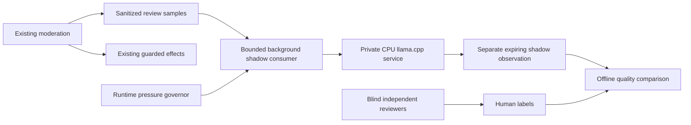

# Commercial advertisement LLM integration

## Current scope

The shadow design below describes the initial observation mode. The implementation
also supports guarded asynchronous `DELETE_ONLY` enforcement and the three-node
pool. In active enforcement, synchronous `COMMERCIAL_AD` results are removed before
AI admission; a missing, expired or refused AI result does not restore baseline
enforcement. A model result alone never grants an effect: current source, policy,
rights, immunity, deadline and exact durable DELETE proof still apply.

The pool's `confirm-positive` policy requires an immediate available 9B consultation
after a positive or uncertain 4B result. A negative 4B result completes without that
consultation. `direct-4b` is a separate supported policy, not the default or an
automatic capacity fallback. Commercial image analysis is retired; image stop-list
OCR is independent.

Use the [pool runbook](../operations/runbooks/commercial-ai-pool.md),
[runtime runbook](../operations/runbooks/commercial-llm-shadow.md),
[quality evidence procedure](../operations/runbooks/commercial-ai-quality-evidence.md)
and [current audit and plan](../operations/plans/2026-11-01-commercial-ai-reliability.md)
for the maintained execution, acceptance and improvement boundaries. Shadow-only
statements, admission budgets and rollback behavior below apply to that initial
consumer, not to active enforcement or the pool.

## Objective and authority

Qwen3.5-9B Q5_K_M supplies a second semantic opinion on Russian commercial
advertisements. The initial implementation is **shadow only**: the existing deterministic
filter and all final delete/access/source/deadline guards remain the enforcement authority.
An LLM positive cannot create a DELETE, mute, ban or reputation observation. An LLM negative
cannot cancel an existing guarded decision. No MAX requests originate from this consumer.

This is a deployment and measurement phase, not model quality certification. A running model,
valid JSON and a few correct examples do not establish advertisement recall or false-positive
rates.

## Architecture

The detector/webhook never waits for inference or enqueues new LLM work. Only the existing
`api-moderation-background` role starts the optional consumer. It polls at most 64 recent
review rows through the existing `(observed_at DESC, id DESC)` index. JSON eligibility checks
follow the limited indexed head; it never scans the 14-day retained history to fill a batch.
It considers the oldest eligible unfinished sample within this head, with a 15-minute lookback.
Overload is dropped by design: `pageCapped` reports a capped head, not a precise dropped-message
count. Repeated scan counts are observations of pages, not counts of unique messages.

Admission requires the existing governor to return `run`, at least 12 GiB host `MemAvailable`,
and a dedicated fail-fast Redis lease/cooldown. There is one client request at a time and at
most one admission per 10 seconds across overlapping consumers. A 120-second lease contains a
90-second work budget and a 60-second absolute inference deadline. Ownership is checked before
inference and persistence; loss aborts the request. Shutdown stops admission and aborts HTTP.
DB statements retain the production timeout; there is no long transaction around inference.

Only unexpired complete **TEXT** samples with source, logical-message and settings identities
are eligible. Review capture already redacts contacts and limits excerpts to 2,500 characters;
truncated, image-required, OCR and incomplete records are excluded. The model sees the excerpt
only, without chat/user IDs, bot credentials, human labels or the detector's decision. It has no
tools, public port or outbound network access. This phase makes no claims about image contents.

## Reproducibility and persistence

The runtime image, GGUF and embedded chat template are pinned by digest in
`infra/scripts/commercial-llm-profiles.mjs`. Provisioning verifies exact byte counts and SHA256
before starting the service. Weights live outside Git, Docker build contexts and API images.
The bounded independent service is limited to 6 CPU, 12 GiB RAM, one slot and 4,096 context
tokens; reasoning is disabled. Its attestation receipt is independent of the three application
release components. See the operational runbook for the guarded installation commands.

The versioned Russian prompt treats the source as untrusted JSON data and asks for
`COMMERCIAL`, `NOT_COMMERCIAL` or `UNSURE` plus a closed set of reason codes. A grammar constrains
JSON generation; the client also validates schema, category/reason consistency, exact model
alias, completion status, response size and deadline. Free-text rationale, quotes, tools,
reasoning and numerical confidence are rejected. A generated confidence is not a calibrated
probability.

`commercial_review_samples.llm_shadow` is an additive nullable JSON column. Results have the
same retention/cascade lifetime as their source sample. Human labels, ratings, review state,
evidence and strict shared quality metadata are not overwritten or exposed to the model.
Source/policy/retention are checked again before a conditional write. Existing execution
enrichment cannot replace this separate observation column.

The input identity binds logical message, exact source snapshot, settings profile, sanitized
excerpt, model SHA, prompt SHA, runtime version and protocol policy version. Mirrored captures
reuse the existing evidence identity; an edit or policy/model/prompt change cannot reuse a
verdict based solely on matching redacted text. Technical failure is stored distinctly and
never interpreted as either class. A sample is attempted once per input identity in this pilot;
transient failures remain visible rather than creating a retry backlog.

## Delivery and acceptance stages

1. **Local and CI validation.** Run focused protocol/HTTP tests and native PostgreSQL/Redis races,
   including concurrent consumers, source expiry/change, blind reviewer preservation, retained
   history bounds, pressure, cancellation, malformed output and dependency failure. Complete
   the impact-selected aggregate, then require exact-SHA `Required` and JavaScript/TypeScript
   analysis before any production mutation.
2. **Bounded installation.** Synchronize reviewed tooling without runtime changes, install and
   attest pinned artifacts under the shared deploy lock, enable the shadow setting and deploy
   the shared API image through the normal release path. Recreate all API roles and native
   auxiliaries without recreating stores. Preserve Svyazka and Karavan resources and routes.
3. **Technical readback.** Verify model/image/template identities, cgroup limits, no public port,
   closed synthetic structured inference, real latency and memory, strict application smokes,
   background heartbeat and recorded coverage/technical failures. Compare the same host and
   sibling-container observations before/after. Report missing samples explicitly. Keep
   historical quarantine separate from new active queue progress.
4. **Independent quality evaluation.** Collect blind human labels, adjudicate disagreement and
   report model-vs-human and detector-vs-human errors separately. Preserve source sampling
   probabilities and report incomplete, excluded and capped coverage. This pilot's admission
   subset is not automatically representative of all messages. Reserve a holdout split by time,
   author and campaign; edits, mirrors and near copies must not cross splits. The existing
   protected-negative/offer/time and confidence-interval gates remain prerequisites for an
   enforcement proposal; do not weaken them to obtain a green result.
5. **Optional enforcement proposal.** Only after quality and latency acceptance, design a new
   explicitly versioned guarded authority. It must retain fresh rights/immunity, source/edit,
   policy and original absolute deadline checks. Inference completion must never renew the
   five-minute text-delete proof. Activating new model-driven effects requires a separate
   reviewed product decision and compatible readers across both rollback paths.

## Training decision

No local fine-tuning is required for installation. Start with the frozen instruction model,
strict prompt and independent error analysis. Fix input completeness or policy ambiguity before
training. If the frozen model repeatedly fails a defined class despite prompt improvements,
prepare an independently labelled train/dev/holdout corpus with campaign separation. Evaluate
classical/reranker baselines alongside LoRA/QLoRA; a larger generative model is not automatically
the best final classifier. Train on a separate GPU machine, never on the shared production
host. Ship a new immutable quantized artifact only after holdout and CPU resource evaluation;
retain the prior model and receipt for rollback.

## Operational evidence and rollback

The consumer uses one optional PostgreSQL connection with a 1,500 ms statement timeout and
1,000 ms lock timeout; it does not change other background SQL budgets. Shadow writes advance
the sample's existing `updatedAt` revision, so an already open review form may need a refresh.

The consumer emits content-free structured `commercial-llm-shadow` observations: heartbeat,
outcome, duration, scanned/ineligible counts and head cap. Redis status expires after five
minutes; stale/missing status is a gap. Model availability and heartbeat are distinct from
successful classifications and independent quality acceptance.

Stopping the optional service immediately removes its CPU load and leaves the existing filter
operational. Disable future admission through the guarded environment operation and the normal
API deployment flow; abort/expiry contains an in-flight observation. Do not delete review rows,
queues, Redis namespaces, other projects' containers or retained model artifacts to roll back.
Old API images ignore the additive nullable column. No rollback may bypass existing reader
floors or the protected deploy lock.

## Independent semantic review and AI export

The closed Safety Desk collects a version-1 semantic annotation with each new complete-text
review. The finite categories are `BUYER_REQUEST`, `PERSONAL_SALE`, `QUOTED_DISCUSSION`,
`NEGATED_OFFER`, `SERVICE_ANNOUNCEMENT`, `NONCOMMERCIAL_HELP`, `MIXED_CONTENT`,
`COMMERCIAL_OFFER` and `INSUFFICIENT_CONTEXT`. Categories describe the shown text; they do
not grant deletion authority. Requests contain only `{version: 1, cohorts: [...]}`.
The server binds each immutable vote to the source snapshot and the exact sanitized excerpt.
The browser cannot supply hashes or reviewer identity. Previous votes, model results and
execution cohorts remain hidden until the reviewer saves their own vote.

Two independently bound annotations must agree, or a third distinct reviewer adjudicates.
Semantic disagreement is tracked separately from label/disposition agreement and appears in
the pending queue. In particular, two agreed KEEP votes still trigger the existing durable
false-deletion stop for the experimental policy; semantic disagreement cannot delay that stop.
A semantic-only third opinion is stored as `SEMANTIC_ADJUDICATION`, including its actual
label/disposition (even UNSURE), while the agreed independent pair retains label authority.
No pre-save response compares that opinion to a hidden label. Every participant still needs
valid independent identity, source coverage and timestamps. Genuine label disagreement retains
its ordinary adjudication path. Old stop readers skip the new kind when selecting the final
label, preserving the two-vote KEEP stop even when execution confirmation arrives later;
old strict review projections reject the unknown kind instead of assigning it label authority.
Old unannotated votes remain missing evidence. Caption-only or incomplete sources cannot
receive a complete-text annotation.

Use the owner-guarded `GET /api/v1/safety-desk/commercial/review/ai-export` with explicit
`since`/`until` (at most fourteen days), optional `cursor` and `limit` (default/max 50).
The ordinary human export remains available. AI export includes only the caller's reviewed,
unexpired human samples and rechecks their exact revision before joining observations.
Dedicated AI rows are diagnostics and cannot receive human ratings or enter the human frame.
The writer stores `human_review_evidence_hash`; the join selects at most two rows by that exact
indexed key before expiry or JSON validation. Multiple generations remain INVALID, including
an expired generation alongside an active one. Absent/expired observations stay null;
malformed/oversized/mismatched evidence stays INVALID. Historical receipts and failures are
exported as observed. Neither path renews source authority or infers a missing KEEP result.

The AI quality reporter derives protected semantic cohorts exclusively from the independently
resolved, source-bound human annotations, never execution `requiredPolicyCohorts`. Missing,
conflicting or mismatched annotations block evidence sufficiency. Statistical thresholds,
separation of labels/permissions/effects and the frozen holdout protocol remain mandatory.
Synthetic local/native fixtures demonstrate the data path; they do not certify model accuracy.

The additive nullable migrations require no backfill. The linkage index and the combined
adjudicator uniqueness index each have their own concurrent migration. A single atomic ALTER
widens the finite rating-kind CHECK with NOT VALID, avoiding a retained-history validation scan;
new writes still reject unknown kinds. The original adjudicator index remains installed.
Old readers can ignore the new columns; rollback must retain all previously installed
execution reader floors and keep these evidence columns. New phone campaign evidence uses
`commercial-campaign:v1:phone-v2:*` so false URL/identifier memberships from the previous parser
cannot influence it. Other campaign histories are preserved; old phone keys expire by their
normal 36-hour TTL without cleanup. Quality comparisons bind the new detector source identity;
old and new source snapshots are not interchangeable. The second-stage process cache version
advances with this change. Commercial OCR and the experimental intent policy require their
existing independent promotion gates.
