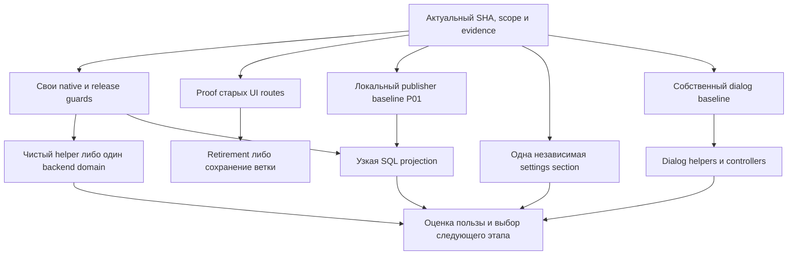

# MAXIM: безопасный рефакторинг и удобство работы агентов

Дата исходного плана: 1 ноября 2026. Source исходного аудита: `3096266b1f81ab50b82da759293fbcc5483f2ead`.
Статус плана: **финальная редакция v4 после проверки безопасности 70 целей**.
Исполнение ведётся изолированными срезами с отдельным подтверждением каждого gate;
наличие ID в каталоге не означает выполненную или выпущенную реализацию.
Проверка безопасности: 01.11.2026 02:12 МСК. Основание и ограничения —
[технический аудит](../../development/refactoring-audit-2026-11-01.md) и
[оценка всех 70 целей](../../development/refactoring-plan-review-2026-11-01.md).
Исполняемые результаты v2 относятся к `6eda89cbc`; дельта `3096266b1` изучена по Git objects
и exact-SHA CI. Нового локального прогона этой дельты данный review не заявляет.
Этот документ задаёт порядок общей программы, сохраняя действующие продуктовые требования,
incident gates и границы разрешений. Он не разрешает destructive recovery или публикации.

Максимальный ожидаемый выигрыш при ограниченном риске дают: достоверные focused/native
проверки; меньшие тестовые стенды; удаление доказанно недостижимых UI-веток; чистые
функции вместо части legacy; независимое владение одним доменом. Изменения SQL selection,
очередей и выполнения внешних действий требуют отдельного измерения и идут позже.
Численных обещаний ускорения без baseline здесь нет. Каталог содержит 66 кандидатов на рабочие микроцели
и четыре отдельно отложенные границы Z01–Z04. Это не обязательство выполнить все строки:
каждый следующий срез выбирается по доказанной пользе и текущей задаче.

Проверка безопасности каждой цели вынесена в
[матрицу допуска и отката](../../development/refactoring-plan-review-2026-11-01.md#safety-matrix).
План не является доказательством корректности будущего diff. Анализ и документы относятся
к исходному срезу; каждая выбранная реализация проходит свой baseline, regression, CI и release gates.
Условие «стоп» относится к указанному execution scope, а не к возможности читать код или
подготовить недостающую проверку. Ни один новый missing test не помечен исполненным.

## Приоритеты и исполнение

| Очередь  | Результат                                                                       | Почему раньше                                                                         |
| -------- | ------------------------------------------------------------------------------- | ------------------------------------------------------------------------------------- |
| P0       | Доказуемые проверки и карта ограничений выпуска                                 | Иначе extraction может пройти mocks, пропустить native cases или заблокировать deploy |
| P1       | Меньше общего тестового контекста, чистые helpers, удалённый UI-код после proof | Большой выигрыш навигации с небольшим изменением поведения                            |
| P2       | Один независимый домен за раз; ясные UI controllers/ports                       | Уменьшение реальной связности, а не числа строк                                       |
| P3       | Измеренная стоимость SQL/выпуска/secondary tooling                              | Большой возможный выигрыш, но выше цена доказательства                                |
| Отложено | Перестройка execution/recovery/state machines                                   | Не начинать без отдельного correctness proof                                          |

Одна микроцель — один проверяемый результат. Исследовательский шаг может закончиться
без изменения кода. В один PR допустимы лишь непосредственно связанные шаги одной
границы; нельзя объединять structural move, исправление продукта, SQL optimization и
смену retry policy. Одновременно активен один implementation/release этап;
независимый read-only review разрешён.



Стрелки обозначают зависимости, а не параллельные runtime workstreams. После первых
P1 результатов нужно пересчитать приоритеты по реальным затратам; не выполнять весь
список автоматически ради завершения программы.

В таблицах запятая означает все перечисленные prerequisites, «либо» — альтернативу,
а текст после точки с запятой — условие для выбранного scope. Общие стрелки диаграммы
не вводят дополнительных зависимостей: P01 и dialog не ждут декомпозиции Admin/settings.

## Размер этапа и цена проверки

Строки — шаблоны срезов. «Один consumer/describe/profile/cluster» означает ровно один
выбранный owner и проверяемый результат; B04 повторяется отдельно для следующего caller.
Если diff требует двух новых state owners, смены persistence mode либо нового protocol,
он перестал быть microgoal и возвращается на разделение. Preparation/review и измерение
могут входить в тот же PR законченного среза; отдельные runtime deploy ради ceiling/CSS
cleanup не обязательны. Обязательные CI/release gates сохраняются для каждого runtime SHA.

До изменения runtime-кода назвать будущую regression matrix и получить baseline.
Если меняется auth/route/storage scope, проверить не только A→B, но A→B→A с задержанным
ответом первого A: совпадение ключа не заменяет incarnation/epoch. Сохранить existing
same-user auth remount и abort старого QueryClient. Для component extraction сохранить
React type/key/DOM placement, focus и local state на повторном render; новое remount policy
не входит в механический перенос. Эти проверки нужны лишь затронутым stateful boundaries.

Existing tests
переиспользуются по scope; одинаковый общий helper для нового implementation и expected
result не считается независимой проверкой. При отсутствии нужной evidence срез остаётся
не готов к реализации, даже когда сама формулировка плана завершена.

## Общий критерий безопасности

Для каждой микроцели перед редактированием:

1. Зафиксировать checkout/SHA/ownership и проверить живой diff; вызвать `context.mjs`
   с implementation, callers и doubles. Состояние длительной работы хранить приватно.
2. По [behavior evidence](../../development/behavior-evidence.md) записать ожидаемое
   поведение и источник. Unresolved behavior исследовать; не закреплять дефект snapshot-тестом.
3. Сохранить HTTP/errors/defaults, callback/queue payloads, persisted readers и keys,
   bot assignments, exact authority и порядок SQL/cache/external effects. Отдельно
   проверить clocks, TTL, дедлайны, null/unknown и principal/entity scope.
4. Запустить необходимые focused cases до/после; при storage/lock/race invariant —
   настоящие PostgreSQL/Redis. Проверить executed/skipped cases, а не один exit code.
5. Для переносимого backend-кода найти source predicates выпуска и rollback fixtures.
   Для DI проверить singleton identity и runtime graph; для UI — действия/запросы,
   lazy assets, cold/warm переходы и budgets, когда они затронуты.
6. Выполнить planner scope, owned formatting и `git diff --check`. Финальный aggregate
   выполняет commit helper один раз. Публичные wrappers сохраняют codegen locks.
7. Runtime: exact-SHA Required + CodeQL, штатный scoped deploy, manifest/identity/strict
   smoke, затем применимые acceptance gates. Для общего API image обновляются все
   роли/auxiliaries по действующей topology, stores не пересоздаются.

Перед выпуском сравнить выбранный SHA с **активными component source SHA**, а не только
с PR base: в диапазоне могут быть ещё не выпущенные изменения других задач. Для каждого
унаследованного cross-product protocol подтвердить совместимый живой provider и порядок
выпуска по его runbook; готовность собственной функции и зелёный PR этого не заменяют.
Применить действующий paired-release fingerprint/admission, когда он нужен. MAXIM deploy
не разрешает обновлять соседний продукт или обходить его gate.

Документация/тесты/tooling не требуют runtime deploy. Планировочный dry-run не является
проверкой. Не копировать старый CI success на новый SHA и не повторять зелёный aggregate
для заполнения статуса. Точный набор проверок выбирается по реальному diff.

Отмена структурного изменения — обратимый code revert **после** проверки допустимости
reader/rollback target; он не означает откат БД, replay effects или снятие fences.
DDL и persisted-format change выводят срез из code-only rollback и требуют отдельного
expand/compatibility решения. До такого изменения указать old/new readers и writers,
смешанный rolling interval, in-flight queue/operation payloads и допустимый old image.
Неразрешённый failed/unfinished/ambiguous migration receipt или частичная схема блокируют обычный
revert/redeploy до reviewed bounded schema+receipt recovery; список finished migrations
не является доказательством целой схемы. Никаких автоматических migrate resolve, down,
DROP, исправления checksum или нового live SQL collector из этой формулировки не следует.
После unknown SEND/DELETE rollback
не разрешает повторить действие. При изменении порядка guards, потере identity, новых
необъяснённых skips, несовместимых readers или изменении публичного результата этап
останавливается для разбора, а не «чинится» ослаблением теста/guard/budget.

## Конкретные исправления после safety review

- B02/B03 сохраняют каждую existing внутреннюю authority check и её момент до SQL;
  запись prior caller check не разрешает добавить skip или unchecked mutation.
- U03/U04 проверяют отсутствие всех writes/clears для sentinel draft: пустой save тоже
  способен удалить local/IDB/native данные. Retired UI removal не является storage migration.
- V03 пока не может считать failure/cleanup доказанными: общий command runner не имеет
  signal-forwarding owner, а async-attachments profile запускает Chromium до try/finally.
  Перед новым adapter нужны exception-safe startup и process-level interrupt/cleanup proof
  выбранного профиля; native/store parent ownership проверяется отдельно.
- V04 проверяет raw Git path/status до downstream normalizer: NUL parsing сам не сохраняет
  leading whitespace/backslash и не решает conflicts/symlinks. Необычный путь либо корректно
  учитывается, либо явно отклоняется/даёт консервативный scope; silent normalization запрещена.
- Для затронутого lazy graph/assets/CSS сохранить policy конкретного caller, reload marker
  и доступный explicit fallback; проверить missing chunk, blocked sessionStorage и повторный
  сбой без reload loop. Missing-export handling неодинаков у existing loaders: не заявлять
  общий fallback и не менять policy массово. Выявленный gap — отдельная correction.
  Automatic reload не доказывает сохранность draft; новая asset-retention система не
  требуется планом. Установленный риск потери состояния останавливает такой move.

## P0 — подготовить проверяемые границы

Таблицы описывают кандидатов и условия допуска, а не текущий реестр внедрений. Evidence
исходной финализации собрана в аудите; актуальность выбранной границы проверяется на SHA
её реализации. Ссылки E01–E11 ведут к разделам исходного аудита.

| ID  | Зависимость                                             | Микроцель и конкретный результат                                                                                                                           | Проверка завершения                                                                                                                                                                                    |
| --- | ------------------------------------------------------- | ---------------------------------------------------------------------------------------------------------------------------------------------------------- | ------------------------------------------------------------------------------------------------------------------------------------------------------------------------------------------------------ |
| A01 | —                                                       | Зафиксировать SHA кода, SHA checkout, owned diff и маленькую карту только выбранной границы: требование, owner, callers, doubles, evidence                 | При новом source проверена дельта и актуальность прежних receipts; карта не дублирует context/planner и не требует полного повторного аудита                                                           |
| A02 | A01                                                     | Для выбранного native-домена сопоставить tests → store-env → текущий CI owner/missing selection; восемь известных gaps использовать как исходные кандидаты | Отделены missing, opt-in и уже покрытые selections; actual executed/skipped известны; добавление selector — только A03, не prerequisite census                                                         |
| A03 | A02,A12; A11 применяется к результату                   | Добавить один отсутствующий native selection в existing CI owner без переразбиения всего lane                                                              | Native conditional cases реально исполнились и не заявлены дважды разными owners; повтор unit cases mixed suite с API base допустим; соседнее покрытие, terminal job status и budget reserve сохранены |
| A04 | A02,A10; только при измеренной цене shell-list          | Вынести literal native membership выбранного baseline в один inventory, сохранив locked public command и shard arguments                                   | Равны множества paths, порядок/аргументы и shard assignments; проверены missing/duplicate/unsupported entries; один production source, без второго runner                                              |
| A05 | A04                                                     | Подключить inventory к focused, сохранив UNION membership и AST canonical store-env; helper-only native dependency указать явно                            | Mixed suite вне lane не теряет native requirement; env aliases/resources и fail-closed остаются прежними; inventory не заменяет AST                                                                    |
| A06 | A01                                                     | Составить evidence map одного выбранного UI flow: pure/source/browser/visual, реальный App или fixture, CI/local owner                                     | Указаны запросы, identity/cancellation и terminal cleanup; не требуется сперва каталогизировать все 89 browser files                                                                                   |
| A07 | A06,A10; только если уже есть два потребителя           | Унифицировать только существующие дублирующие CI/visual browser selections; будущий focused не считать уже существующим consumer                           | Есть два concrete callers и selection-equivalence; public scripts/timeout/retry/cleanup не меняются; если второго consumer нет, шаг откладывается без блокировки V03                                   |
| A08 | A01; затрагивается runtime/release source boundary      | Найти predicates/rollback readers выбранного переноса; добавить negative fixture лишь для реально непроверенного refusal                                   | Старый/новый target SHA, отсутствующий файл, unsafe reader и guard order проверены; trusted checker не подменён кодом target; не переписываются все guards                                             |
| A09 | A01; изменился domain entrypoint или найдена stale note | Обновить одну существующую scoped reference и её указатели; сохранить историю отдельно                                                                     | Один актуальный маршрут навигации, нет второй базы задач и дублирования требований; docs/guidance budgets; не блокирует unrelated adapter                                                              |
| A10 | A01; заявляется выигрыш agent workflow                  | Снять маленький baseline 3–5 повторяемых задач одного scope: контекст, первый focused result, исправления команд и skips                                   | Одинаковая методика/стартовые условия до и после; discovery и execution time различаются; нет процентов экономии или p95 из нескольких наблюдений                                                      |
| A11 | A02; применяется к выбранному CI result                 | Связать report с SHA/run/attempt/job/phase и ожидаемыми cases; использовать existing exact-SHA assert-green для final check status                         | Cancelled job не становится зелёным от success JSON; duplicate artifacts/allowed skips различимы; это узкий receipt, не новый CI orchestration layer                                                   |
| A12 | A02; планируется расширение native lane                 | Оценить бюджет затронутого job: setup, tests, upload, teardown и наблюдаемый разброс до нового selector                                                    | Сохранены timeout и same-SHA rerun; есть резерв и ограниченная диагностика причины; два запуска не превращаются в p95 и не оправдывают увеличение deadline                                             |

A08 выбирает затрагиваемые predicates до backend moves; чисто тестовый перенос не
требует переделывать все 567 predicates. Учитываются также standalone source checkers.
A04 сначала сохраняет выбранное множество; добавления A03 затем согласуются отдельным diff.
Допустимо сначала выпустить A03 как узкий CI fix, затем строить inventory из обновлённого
проверенного списка: новый baseline фиксируется явно. Нельзя смешать сравнение списков
с незаметным исключением старых suites.

## P0/P1 — authority и совместимость сохранённых операций

Эти небольшие карты дополняют existing domain references; новый центральный registry
прав или новая база задач не создаются. S01/S03 выбираются для конкретной переносимой
границы. Они не заставляют изучать все integrations перед переносом pure renderer.

| ID  | Зависимость                                        | Микроцель и конкретный результат                                                                                              | Проверка завершения                                                                                                                                                                                                                                                 |
| --- | -------------------------------------------------- | ----------------------------------------------------------------------------------------------------------------------------- | ------------------------------------------------------------------------------------------------------------------------------------------------------------------------------------------------------------------------------------------------------------------- |
| S01 | A01; переносится authority/auth boundary           | Для выбранной границы связать вход/signature/session/profile с actor/entity authority и разрешённым эффектом                  | Сохраняются invalid vs expired, launchBotId/lifecycle, origin/CSRF/tunnel и skip-option owner; pure renderer не требует обзора всех auth integrations                                                                                                               |
| S02 | A01,S01 для auth; сначала принят ID/error contract | Отдельным исправлением добавить typed signed-user decoder; не менять session records/TTL/keys                                 | Реальный signer: valid string/number/user_id и malformed user/id дают согласованный результат; rotation/freshness/recovery прежние; old processes до convergence ещё используют старый decoder; existing sessions не исправлены, rollback pre-fix возвращает дефект |
| S03 | A01; переносится network storage boundary          | Составить map writer → trigger/revision → reader → lease/receipt → rollback; A08 выбрать по своим source floors               | Совместимый v3 работает; unsupported/section-incompatible reader unsettled; receipt co-commit и stale lease no-write; SQL proof отдельно от mocked MAX permission                                                                                                   |
| S04 | A01; меняется конкретный внешний protocol          | Для одной consumer/provider pair закрепить versions, command/hash/witness/receipt и unknown/fallback rules в existing runbook | Reproducible compatibility fixtures точных versions; Karavan сохраняет ID/payload, statistics partial sweep не отзывает absent, malformed/auth не fallback; live acceptance лишь по rollout scope, не ради docs/pure move                                           |

S02 — подтверждённый malformed-input boundary, отдельный от behavior-preserving refactor.
Текущее `null → TypeError` воспроизведено, но production incident и unsigned обход не
установлены. Это не основание менять все accepted IDs или превращать invalid signature
в session recovery. Самостоятельные `S04` изменения протокола не входят в pure extraction.

## P1 — тестовые границы и чистые функции

Основание: [E03](../../development/refactoring-audit-2026-11-01.md#e03-backend-boundaries),
[E04](../../development/refactoring-audit-2026-11-01.md#e04-private-control-and-max).

| ID  | Зависимость                                                    | Микроцель и конкретный результат                                                                                                             | Проверка завершения                                                                                                                                                                                                    |
| --- | -------------------------------------------------------------- | -------------------------------------------------------------------------------------------------------------------------------------------- | ---------------------------------------------------------------------------------------------------------------------------------------------------------------------------------------------------------------------- |
| T01 | A01; выбран ограниченный Admin test domain                     | Перенести один небольшой самостоятельный describe, например allowlist normalization, сохранив setup/cleanup и test discovery                 | До/после равны case identity и assertions; соседние cases сохранены; describe на тысячи строк не считается microgoal; expected result не вычисляется тем же новым helper; production-код не меняется                   |
| T02 | A01; выбран затрагиваемый harness                              | Типизировать один double/port против реального контракта; T01 нужен только если помогает его scope                                           | Ловятся signature drift и неожиданный вызов; mutable singleton/lifecycle не потерян; нет all-domain fixture и структурного cast, лишь маскирующего несовпадение                                                        |
| T03 | A01; переносится достижимый feature path                       | Подключить конкретный real guard только для выбранного достижимого OCR/profanity/image path; T02 выполнить при изменении double              | Виден сам guard call и разрешённый/запрещённый observable effect; retired photo policy off доказывает только no-delete drain; active IMAGE идёт через message-duplicate, DI construction не считается feature coverage |
| T04 | A01,A08; свой private corpus                                   | Перенести один чистый rules-rendering cluster с явными входами; Nest/session/callback owner оставить на месте                                | Выбранные из 131 existing private cases плюс необходимые лимит/язык/null edges до/после; точные тексты, markup length и порядок; не запускать весь unrelated Admin suite                                               |
| T05 | A01,A08; свой payload corpus                                   | Вынести один действительно чистый MAX payload cluster; existing keyboard helper переиспользовать, logger warnings оставить в service adapter | Сохранены omitted/null/forwarded/unknown attachments и payload формы, warnings и defaults; диапазон методов целиком не объявлен pure; admission/final guard/HTTP и retry policy не двигаются                           |
| T06 | A01,A08; свой membership corpus                                | Вынести один parsing/projection cluster webhook с прежними clock и dedupe boundaries                                                         | Сохранены duplicate join repair, cross-bot identity и каждый clock read; SQL/cache commit order не переносится; storage proof лишь при затронутом storage call                                                         |
| T07 | T04 либо T05 либо T06; ceiling уже существует для своего scope | Уменьшить существующий ceiling на фактически перенесённые строки в том же завершённом срезе                                                  | У private legacy ceiling есть, у MAX/webhook этого лимита нет: новый не обязателен; нет пустых forwarders, unguarded переноса долга или illegal legacy imports; отдельный deploy ради ceiling не нужен                 |
| T08 | A01; повторяемый warning либо затронуты startup/signal/cleanup | Проверить cleanup одного harness/runner при setup/body/teardown failure и process interruption; менять лишь выявленный owner                 | Для adapter: parent/child SIGINT/SIGTERM и startup rejection не оставляют owned Vite/browser/store/listener и не убивают foreign process; worker-mode warning не чинится forceExit/runInBand; bounded diagnosis        |

T01 — необязательный для чужих доменов шаблон одного Admin-среза, не разрешение
одновременно разнести все 31 тысячу строк. T04 использует собственный private baseline.
Разделение tests и изменение production implementation должны иметь независимо
объяснимый diff. Полезные existing tests: `admin-domain-allowlist-runtime.spec.ts`,
`admin-domain-allowlist-runtime-context.spec.ts`, `admin-legacy-port.providers.spec.ts`,
`runtime-role-graph.spec.ts`, `private-control.service.spec.ts`, `max-client.service.spec.ts`,
`webhook.service.spec.ts`. Сначала выбрать cases; не запускать весь этот перечень для
каждого изменения.

## P1 — доказать и убрать старые publishing-ветки settings

Основание: [E05](../../development/refactoring-audit-2026-11-01.md#e05-frontend-state).
Возможный выигрыш — уменьшение state/effects/imports и контекста; размер bundle проверяется
отдельно, заранее не обещается.

| ID  | Зависимость                                                          | Микроцель и конкретный результат                                                                                                  | Проверка завершения                                                                                                                                                                                              |
| --- | -------------------------------------------------------------------- | --------------------------------------------------------------------------------------------------------------------------------- | ---------------------------------------------------------------------------------------------------------------------------------------------------------------------------------------------------------------- |
| U01 | A01; A06 для выбранного flow                                         | Перечислить mounts, preload, dynamic/fixture callers и retired-link predicates только chat/channel scope                          | У каждой ветки доказан caller или недостижимость; наличие query само по себе не доказывает retired state; полный browser catalog не prerequisite                                                                 |
| U02 | U01; A06 для этого flow                                              | Проверить настоящий App routing matrix с instrumented transport либо HTTP session mocks и положительным ordinary-settings control | Видимый handoff и absent settings editor; positive control регистрирует settings request; retired forbidden effects отсутствуют; warm counters отделяют прежний in-flight request, ordinary mixed-query сохранён |
| U03 | U02 для chat; branch действительно недостижима                       | Удалить одну chat publishing reverse slice, сохранив mixed effects timing и текущие local persistence boundaries                  | Retired/split effects не пишут и не удаляют sentinel draft во всех mirrors; empty save не трактуется no-op; ordinary handoff/shared helpers/overlays проверены; storage migration отдельно                       |
| U04 | U01,U02 для channel; U03 необязателен                                | Отдельно доказать и удалить одну channel branch без копирования chat state/retry semantics                                        | Свои positive/negative channel flows; sentinel local/IDB/native без writes/clear/empty-save; signature/quick buttons/comments и shared helpers прежние; один entity scope на release                             |
| U05 | U03 либо U04; свой scope                                             | Imports и existing ceiling очистить с removal; CSS удалять только после bounded selector/consumer census                          | Broadcast-screen используется active rules; composer styles нужны Publications; cascade/cold/warm сохранены; новые ceilings не создаются; keyboard/safe-area matrix по реальному layout scope                    |
| U06 | A01; после выбранного U03 либо U04 и его U05                         | Сравнить production-origin assets и один agent task с baseline, снятым до removal                                                 | Равны env/lockfile/build mode; startup/incremental route budgets не ослаблены; статистическая погрешность и отсутствие bundle gain названы; measurement входит в acceptance самого removal                       |
| U07 | A01; воспроизведён mixed-query error retry и подтверждено требование | Отдельно решить expected result лишнего publishing GET и лишь затем внести узкую correction                                       | Failing regression и neighboring handoff cases; не ждёт полного U02 catalog, не маскируется structural removal и не блокирует независимый U03                                                                    |

### Обязательная матрица U02

Проверять chat/channel, cold entry и warm переход из settings; `focus=broadcast&handoff=1`,
`focus=mailing`, `workspace=autoposts`, наличие даже пустого legacyKind/legacyId; обычные
rules/giveaway/polls/storefront, отдельно `focus=giveaway&handoff=1` и load error → retry.
Launch/startapp/hash варианты проверять при затрагивании соответствующего resolver.
Publisher publications/entity screens остаются собственными runtime routes.

Forbidden endpoint set задаётся явно для retired entries. Для обычного mixed-query
фиксируется текущее поведение; у chat оно включает publishing GET на error retry,
у channel такого ordinary retry GET нет. Его возможное
изменение относится только к U07. Session bootstrap, `/me`, разрешённый favorites
read и module/CSS preload сами не являются нарушением. In-process preview требует
instrumented ApiTransport, HTTP observer один не доказывает no-fetch. Built real App с
session mocks — альтернативный путь; direct page fixture root guard не проверяет.

Если U01/U02 выявят действующего caller, удаление соответствующей ветки прекращается.
Её изолировать можно отдельным решением с подтверждённым поведением. Независимый F01
не ждёт U02/U06; при overlap нужен caller/behavior proof соответствующей ветки.
Удаление U03–U06 не является обязательным. Ранее утверждённые
[продуктовые решения](../../development/miniapp-product-decisions.md) сохраняются.

## P2 — один настоящий backend domain owner

Первый кандидат — allowlist: уже выделенный runtime с явным context, но legacy остаётся
посредником. Цель — не создать ещё один facade поверх всего `AdminService`.

| ID  | Зависимость                                        | Микроцель и конкретный результат                                                                                 | Проверка завершения                                                                                                                                                                                            |
| --- | -------------------------------------------------- | ---------------------------------------------------------------------------------------------------------------- | -------------------------------------------------------------------------------------------------------------------------------------------------------------------------------------------------------------- |
| B01 | A01; scope-specific S01/S03 по затронутым границам | Составить allowlist census controllers/manual/private/network/cleanup и state/authority/cache/transaction owners | Read-only census не требует заранее A08 fixtures или test-file move; direct private calls, expired/removal options, triggers и receipts включены                                                               |
| B02 | B01; свой typed double при необходимости           | Ввести только domain signatures и узкий port, не меняя владельца/момент existing authority checks                | Get/add/remove/schedule сохраняют внутренний assertChatAdmin до SQL; existing skip лишь там, где уже есть prior check; никаких новых unchecked writes, Parameters/ReturnType от legacy или mega-port           |
| B03 | B02; A08 и applicable S01/S03                      | Переключить одного consumer на фасад того же runtime/state owner, сохранив все authority checks                  | Реальная deny-before-data граница и singleton/lazy getter/lifecycle identity подтверждены; caller map не разрешает удалить внутренний guard; audit/cache/effect order прежние, второго owner нет               |
| B04 | B03; S03 только для network consumer               | Переключить ровно одного следующего manual/private/network caller; повторять отдельным срезом                    | Options/permissions и SQL+audit→cache order прежние; post-commit failure не даёт mutation retry; network сохраняет outer tx/commitOnly/onCommitted и receipt-resume только followup, без обычного CRUD wrapper |
| B05 | Приняты все выбранные B04; applicable A08/S03      | Удалить один действительно неиспользуемый legacy forwarder/provider после census оставшихся calls                | Все затронутые DI profiles, identity и lifecycle owner прежние; negative rollback fixtures сохранены; перенос DI ownership только при доказанной необходимости                                                 |
| B06 | Принят B03 либо один B04/B05                       | Оценить выигрыш завершённого среза и выбрать следующий домен либо остановить декомпозицию                        | Снизились обязательный контекст/зависимости, overhead ports не вырос; B05 не обязательная цель любой ценой; один следующий implementation stage                                                                |

Нужные storage доказательства включают existing `network-navigation-allowlist-postgres.spec.ts`
и `network-settings-postgres.spec.ts`, когда меняется wiring/граница их реального вызова.
Если authority невозможно вынести без цикла или разделения state, B05 откладывается:
узкая совместимая граница B03 сама по себе полезна, но не называется полной декомпозицией.

## P2 — settings, dialog и events по границам состояния

| ID  | Зависимость                                                 | Микроцель и конкретный результат                                                                                                 | Проверка завершения                                                                                                                                                                                                                                                                                                                                                          |
| --- | ----------------------------------------------------------- | -------------------------------------------------------------------------------------------------------------------------------- | ---------------------------------------------------------------------------------------------------------------------------------------------------------------------------------------------------------------------------------------------------------------------------------------------------------------------------------------------------------------------------- |
| F01 | A01; concrete remaining cluster и свой A06, U01 при overlap | Выбрать ещё не выделенную presentation model одной settings section либо принять existing helper как достаточный                 | Польза consumer/context доказана; useSettingsDraft revision/conflict прежние; section metadata/shared rendering уже существуют; независимый срез не ждёт U02/U06, допускается no-op                                                                                                                                                                                          |
| F02 | A01; свой section census и browser baseline                 | Для allowlist вынести только bounded presentation через existing ReactNode port и прежние callbacks                              | Immediate add/remove/schedule, count/payload/errors/invalidation прежние; React type/key/DOM placement/focus/local state стабильны на rerender; нет нового remount/stale-callback policy; controller move отдельно                                                                                                                                                           |
| F03 | A01; A06 для dialog, C04 если меняется fixture              | Первым вынести только existing 59-line `toggleDialogReactionLocally`; mutation callbacks и независимый preview transport прежние | Frozen input и unrelated references сохранены, outputs заданы literal. Inverse только для unique-emoji groups с не более одной own при initial no-own либо own=target; сравнивать per-emoji count/own без требования исходного порядка. Switch→remove имеет отдельный literal expected, прежняя reaction не восстанавливается; cancel/snapshot/update/rollback order прежний |
| F07 | A01; свой attachment baseline                               | Вынести только existing CommentMessageAttachments с прежними props/keys/DOM/click handlers; F03 не prerequisite                  | MIME/URL/missing fallback, click propagation/album index и stable React/DOM identity на rerender; gallery/modal/native Back/download/scroll owners прежние; compose/viewer/lazy-loading не включаются автоматически                                                                                                                                                          |
| F04 | A01; свой async attachment corpus и реальные runtime mounts | Выделить один owner generation/cancel/async preparation только у реально затронутого dialog flow                                 | API/user/profile/entity/chat/dialog/token/capability и A→B→A epoch сохранены; late import/read/edit/unmount, limits/partial results и cleanup; active suggest — отдельный keyed page, старые ветки не расширяют scope                                                                                                                                                        |
| F05 | A01; A06 для реально затронутого dialog и behavioral corpus | Сначала выделить query + terminal-stop owner одного runtime dialog; mutation family и suggest page отдельно                      | Таймер/refocus/retry/in-flight прекращаются после terminal, A→B→A и same-user auth remount fenced; moderation/Publisher проверяются явно; canonical QueryClient/key и reaction rollback за своим scope                                                                                                                                                                       |
| F06 | A01; свой A06 и real EventsPage read-state baseline         | Выделить только dashboard query/snapshot/read model; participant mutations и review workspace оставить                           | Keyed chat/range/include flags, initialDataUpdatedAt=0, delayed hydration и display/current/authoritative identity; cached-only snapshot не разрешает mutation; feed hook tests не заменяют page behavior                                                                                                                                                                    |

F03 не зависит от удаления settings-кода и может быть выбран следующим этапом вместо
F01/F02, но не вести оба runtime этапа одновременно. Имеющиеся feed/rules/subscription
hooks, shop journal и Safety Desk guard не переписываются под универсальный async hook.

Для нового source `3096266b1` магазин учитывает независимые границы: daily management
с проверенными access/binding generation не блокируется connection recovery; connection
commands сохраняют original chat/key/request и attempt identity. Retry снова проходит
свой IDB journal fence с тем же command ID. `saveMirroredItem` — best effort, не durable
commit proof; web SDK storage считается недоступным даже при наличии методов. UI removal
и controller extraction должны сохранить эту асимметрию, не делать общий loading/error gate.

## P2 — contracts и входные данные

| ID  | Зависимость                                                | Микроцель и конкретный результат                                                                             | Проверка завершения                                                                                                                                                                                                               |
| --- | ---------------------------------------------------------- | ------------------------------------------------------------------------------------------------------------ | --------------------------------------------------------------------------------------------------------------------------------------------------------------------------------------------------------------------------------- |
| C01 | A01                                                        | Выбрать один действительно ациклический core leaf и составить consumers + defaults/issues corpus             | Учтены runtime/public exports/source/Jest aliases и schema dependencies; initial target/schema leaf не тянет весь core обратно; type-only imports не считаются bundle defect                                                      |
| C02 | C01; A08 если source predicates затронуты                  | Перенести один leaf с прежними exports, z.input/z.output и canonical definition без leaf→core цикла          | Root/subpath identity отдельно в source/Jest и actual built mode; independent ordered issues code/path/message, defaults/coercion/caps-before-dedupe; affected old/new readers/wire совместимы; schema change не маскируется move |
| C03 | A01; подтверждён accepted HTTP/error contract              | Перевести одну baseline boundary на unknown + existing runtime schema без расширения scope                   | Valid/default/extra-key/coercion/invalid statuses и authority проверены; если схема меняет accepted input — отдельная correction; exception удаляется только после proof                                                          |
| C04 | A01; выбранный fixture стал evidence изменяемого контракта | Типизировать один valid builder/harness и включить настоящий либо сгенерированный TSX в узкую test typecheck | Runtime parse и static check различаются; corrupt negative payloads не нормализуются builder; embedded TSX в .mjs не считается typechecked; один объяснённый generic-dispatch cast допустим, blanket casts нет                    |

Не разрезать большой chatSettings refine/transform без отдельного corpus. Не добавлять
runtime Zod во все UI clients ради одинакового стиля: сначала доказать boundary gap и
учесть route budgets. Prisma models/DDL в этот этап не входят.

## P2 — инструменты агентов и visual tooling

| ID  | Зависимость                                                           | Микроцель и конкретный результат                                                                                | Проверка завершения                                                                                                                                                                                                                                         |
| --- | --------------------------------------------------------------------- | --------------------------------------------------------------------------------------------------------------- | ----------------------------------------------------------------------------------------------------------------------------------------------------------------------------------------------------------------------------------------------------------- |
| V01 | A01,A10; часто нужен selected Lastik unit file                        | Сначала определить selective public command contract, затем добавить один focused adapter без bypass runner     | Existing npm test имеет glob: добавленный path не выдаётся за selection; проверены единственный выбранный file, exact args/UTC/exit; A09 не prerequisite                                                                                                    |
| V02 | A01,A10; выбран native Lastik scope, V01 необязателен                 | Добавить selective Lastik stores route при реальной потребности поверх одного public storage owner              | Exact selection; MAXIM_TEST_POSTGRES_URL и MAXIM_TEST_REDIS_URL и UTC, свои schema/migrate/cleanup; missing/mismatch env — отказ до spawn; текущие conservative PG+Redis resources не сужать молча; parent signal cleanup, no nested stores/phantom aliases |
| V06 | A01,A10; измерена потребность API Node-native selection               | Рассмотреть adapter только existing retention/storage public family после доказанного public selective dispatch | Exact file/args/UTC/env/exit, codegen locks и API migrate owner; missing/mismatch native env — отказ до spawn, без PGlite fallback/Redis skips под native label; fixed list не сужается appended path, benchmark suffix недостаточен                        |
| V03 | A01,A06,A10; T08 process/startup gate выбранного профиля              | Добавить один browser adapter лишь после exception-safe startup и доказанного process/lifecycle owner           | Known async profile launch-before-finally и generic runner signal gap закрыты до admission; fault/parent-only signal проверены actual process; нет orphan owned server/browser/port, borrowed server сохраняется; CI coverage отдельно                      |
| V04 | A01; known selection failure либо measured maintenance cost           | Переключить visual selection на canonical NUL collector с raw path/status contract до normalization             | Leading whitespace/backslash/newline и оба rename paths не теряются в downstream trim; conflict/symlink/unmerged имеют явную reject/conservative policy; override и Git failure fail-closed; old/new scopes покрыты                                         |
| V05 | A01; конкретный ещё не выделенный pure cluster и свой visual baseline | Перенести одну pure geometry/report computation, если навигационная польза выше цены переноса                   | Уже выделенный miniapp-smartphone не переделывается; page/evaluate и lifecycle остаются у owner; fractional metrics/tolerance/report fields прежние; V04 не prerequisite                                                                                    |
| V07 | A01; свой selected visual profile, V04 необязателен                   | Перенести behaviors одного домена и проверить registry ↔ metadata в обе стороны                                 | Те же IDs/action order, local/Major defaults, faults/cleanup и effects observations; screenshot file сам по себе не является pass                                                                                                                           |

Выбирать V01–V03 и V06 по замерам A10: новый adapter оправдан частым реальным использованием,
а не полнотой каталога. Не вводить второй scheduler поверх plan/verify/focused.

## P3 — runtime performance только после измерения

Основание: [E09](../../development/refactoring-audit-2026-11-01.md#e09-measurement-and-scope)
и действующий domain-specific publisher plan. Эти шаги не возобновляют автоматически
остановленные программы rollout или необратимые операции.

| ID  | Зависимость                                             | Микроцель и конкретный результат                                                                                                               | Проверка завершения                                                                                                                                                                                                                |
| --- | ------------------------------------------------------- | ---------------------------------------------------------------------------------------------------------------------------------------------- | ---------------------------------------------------------------------------------------------------------------------------------------------------------------------------------------------------------------------------------- |
| P01 | A01; конкретный оставшийся full-row/scan bottleneck     | Начать с existing publisher smoke; полный 10k/50k профиль — только для выбранного оставшегося bottleneck в disposable stores                   | Изолированы MAX/Redis/heartbeat synthetic effects, все cells/postconditions/cleanup; width/cardinality/actual work различаются; reports/source digests и sample gaps сохранены; не требуется unrelated extraction                  |
| P02 | P01,A08; новый выигрыш ещё не реализован                | Выбрать один remaining full-row reader, затем field-consumer matrix и single-snapshot projection                                               | Не менять where/order/cardinality/query count и durable fields/versions/keys; select/GetPayload/generated SQL и consumed fields совпадают; repairs/finalizer/authority прежние; persisted drift — stop/D, не code-only rollback    |
| P03 | P01; свой read-site corpus                              | Определить race/field matrix до изменения runtime-кода P02, затем проверить его baseline/candidate через independent DB connections и barriers | P02/P03 один связанный PR без промежуточного deploy; both sides stop/revoke/edit/cancel/lease/receipt, no selector tautology; existing E4/D15 cases переиспользуются, unrelated suite не повторяется                               |
| P04 | P02,P03; измерен выигрыш и resource flags рассмотрены   | Выпустить только прошедший correctness/benefit gate projection с неизменным durable contract                                                   | Exact-SHA Required/CodeQL/deploy/manifest и свои acceptance; old/new+in-flight совместимы; persisted drift — отдельный D/E plan; нет benefit/есть необъяснённая memory/CPU regression — no rollout; старые проценты не переносятся |
| P05 | P04; доказан оставшийся bottleneck и отдельный go/no-go | Только исследовать возможность two-phase read/bounded continuation без включения новой execution authority                                     | Version/snapshot/composition/order/final authorization и обе стороны race доказаны; иначе решение no-go; implementation потребует отдельного плана, не расширяет Z03 автоматически                                                 |
| P06 | P01 либо P04; bottleneck находится в access path        | Исследовать один index/DDL вариант на representative disposable workload; не применять автоматически                                           | Explain rows×loops/buffers, WAL/write cost, concurrent compatibility и rollback class; отсутствие benefit завершает hypothesis; reviewed baseline debt не удаляется full Prisma diff                                               |

Не заявлять O(1) из-за `LIMIT`, маленького output или quantum. Не удалять finalizer/repair
из-за «обычно не нужен». Нельзя превращать SQL error/empty SKIP LOCKED в completion.
Старые synthetic цифры и pure-helper benchmarks не являются production latency.

## P3 — инфраструктура и независимый Lastik

| ID  | Зависимость                                              | Микроцель и конкретный результат                                                                             | Проверка завершения                                                                                                                                                                                                             |
| --- | -------------------------------------------------------- | ------------------------------------------------------------------------------------------------------------ | ------------------------------------------------------------------------------------------------------------------------------------------------------------------------------------------------------------------------------- |
| O01 | A01,A08; runtime move действительно требует checker seam | Выделить один capability checker за прежней shell entrypoint лишь после trusted-helper transition proof      | Точный trusted helper доступен до/после checkout switch и не берётся из target; missing/substitution/symlink/unsupported target — refusal до mutation; target source только data; order/floors/reasons/rollback callers прежние |
| O02 | A01; concrete residual topology drift                    | Проверить residual TS/rendered Compose/Bash/auxiliary/image parity в обе стороны; генерацию решать после gap | Нет missing и unexpected API roles/auxiliaries; service names, image/queue/capabilities и fallback совпадают; existing presence-only test не считается bidirectional parity; no gap — no-op, secrets/concurrency прежние        |
| O03 | A01; public Lastik runner своего scope                   | Выделить только общую canonical operation-hash function вместо дублей                                        | Побайтово тот же serialization/order/null/string/number digest на golden corpus; types не объединяют разные protocols; dispatch/settle и database fields прежние                                                                |
| O05 | A01; public Lastik runner своего scope                   | Перенести только чистую diagnostics projection и её types                                                    | Null/unknown/partial/status/timing fields прежние; нет дополнительных SQL или effect из getter; hash, runtime port и transactions не меняются                                                                                   |
| O04 | A01; реально мешает concrete Store dependency            | Ввести минимальный Pick/port для используемых runtime Store methods и typed double                           | Не дублируется весь Store; compile contract + health/recovery/due/rate/retry по scope, native when invariant needs it; advisory/policy locks/leases/attempts/unknown и bridge сохраняются                                       |

Для O03/O04 adapters V01/V02 необязательны. Existing public Lastik scripts запускают
целое семейство через glob: добавление пути не делает их selective. Если нет отдельного
поддерживаемого selective route, честно использовать whole-family command по своему scope.
Native specs читают `MAXIM_TEST_POSTGRES_URL`/`MAXIM_TEST_REDIS_URL`, сами создают isolated
schemas, вызывают Lastik migrate и очищают их. Generic `with-test-stores.mjs --migrate`
мигрирует API Prisma, не Lastik; runtime `ERASER_*` aliases он не создаёт.

Host-wide cleanup, чужие services, stores recreation и token sharing не входят в программу.
Новые abstraction не должны объединять независимые Major/Lastik state machines.

## Отложенные границы: отдельные решения

| ID  | Участок                                                                     | Условие перед возможной реализацией                                                                                                                   |
| --- | --------------------------------------------------------------------------- | ----------------------------------------------------------------------------------------------------------------------------------------------------- |
| Z01 | Moderation webhook handler/timeout settlement                               | Матрица preparation/failure/persist/timeout/detached/quarantine; native fullpath и latency regression matrix; никакого общего retry wrapper без proof |
| Z02 | Delete-intent executor и независимые причины                                | Явная state machine + lease/dispatch/receipt/unknown/fresh authority proofs; целостные транзакции и regression обеих причин                           |
| Z03 | Publisher readiness/seals/new materialization/DDL                           | Актуальный domain plan, сравнительный native correctness proof и writer census; certificate не выдаёт SEND authority                                  |
| Z04 | Native auxiliaries, broad dependency/compiler upgrades, новые microservices | Измеренный bottleneck и отдельный compatibility/lifecycle rollout; no-network/no-secret/kill-reap и бюджеты сохраняются                               |

Массовое переименование файлов, универсальный repository/event bus/mutation hook, рост
quotas/concurrency, очистка Redis/очередей и удаление uncertainty fences не являются
микроцелями этого плана. Снижение числа строк не оправдывает такие изменения.

## Первый практический цикл

1. A01: выбрать одну границу и заморозить source. Для native CI gap — узкие A02/A12,
   один A03 и применимый A11. Восемь кандидатов исходного аудита прошли локально на его baseline;
   перед выбором проверить текущие selectors и выполненные срезы, исключив уже закрытые gaps.
   Сохранять свежесть receipts по изменившимся inputs.
2. Для agent workflow сначала маленький A10. Из structural runtime кандидатов первым
   рассмотреть T04 либо F03: оба имеют ограниченный pure seam. Если текущая задача UI,
   она не ждёт устранения unrelated backend CI gap. Выбор зависит от нужного домена.
3. S02 выбирать отдельной correction после ID/error contract; U01/U02 → один U03 либо
   U04 — после route proof. Их нельзя объединять с pure extraction в один результат.
4. После первого принятого среза сравнить пользу/цену проверки и выбрать следующий.
   B-domain move, inventory, adapters и P01 запускаются по своему подтверждённому основанию.

Это следующий маршрут выбора, не разрешение начать все ветки. A01/A08/S01/S03 — маленькие
проверочные карточки выбранного scope; не превращать их в четыре новых framework или
повторную инвентаризацию всего проекта. После двух принятых runtime срезов пересмотреть
программу; прекратить кандидатов без измеренной пользы.

## Допуск реализации и совместные риски

По safety matrix исследовательские цели допускают чтение/локальные controlled measurements
в своём scope; «условно» требует stated evidence перед изменением runtime-кода/release; «стоп»
запрещает указанное выполнение до устранения конкретного пробела; Z01–Z04 остаются отложены.
Все runtime строки требуют новых before/after на exact diff, не доверяют старому green cache.

Если два среза используют общий state/schema/CSS/runner/provider, второй повторно выбирает
baseline на принятом SHA первого. Результаты test split и extraction не суммируются как
два независимых proof, если ожидание и implementation используют один helper. Старые web
clients и in-flight jobs обязаны оставаться совместимыми по затронутому contract; clock,
key, hash, reader/version и permission policy не меняются автоматически от нового файла.

## Риск, результат и конечный критерий программы

| Пакет           | Ожидаемый выигрыш                               | Главный риск                                                | Разрешённый первый результат                                                    |
| --------------- | ----------------------------------------------- | ----------------------------------------------------------- | ------------------------------------------------------------------------------- |
| A02/A03/A11/A12 | Достоверное покрытие и предсказуемый feedback   | False green, пропавший case, job timeout                    | Один native owner с executed cases и полным terminal CI receipt                 |
| T01/T02/C04     | Меньше контекста и обнаружение drift до runtime | Fixture перестала моделировать реальный контракт            | Один typed domain harness с тем же observable corpus                            |
| `S02`           | Корректная signed-input boundary                | Изменение accepted IDs/session semantics                    | Узкий decoder с подтверждёнными valid/invalid cases                             |
| U01–U06         | Меньше state/effects/imports без потери функций | Mixed handoff и shared helpers ошибочно удалены             | Удалена одна доказанно недостижимая ветка; warm/cold реальные flows сохранены   |
| T04–T06         | Изолированная чистая логика                     | Текст/clock/dedupe/guard order изменились                   | Один pure cluster с before/after corpus                                         |
| B/F/S03/S04     | Меньше связности домена                         | Разделён singleton, authority, receipt или principal        | Один законченный owner с native/permission evidence по своим границам           |
| P/O             | Измеренное снижение стоимости                   | Snapshot, reader, lifecycle или effect uncertainty нарушены | Минимальный прошедший correctness gate шаг; отсутствие выигрыша допускает отказ |

У программы нет цели завершить все строки любой ценой. Рабочий этап закончен, когда
его owned diff завершён и проверен, обязательные CI/release/acceptance gates выполнены,
старые readers/fences совместимы, а выбранный показатель улучшен либо гипотеза отвергнута.
Программу пересматривать после первых двух принятых runtime срезов: продолжать только
пакеты с измеренной пользой, отложенные/отвергнутые кандидаты сохранять с причиной.

Карточка каждого будущего этапа в private task record: ID, exact SHA/source digest,
expected/authority, scope/callers, test command + executed/skipped cases, rollback class,
owner state/lifecycle, risk, terminal result и следующий gate. Для persisted/external
изменений отдельно old/new readers/writers и что разрешено после unknown outcome.

Rollback classes: docs/tests/tooling — code revert после проверки inputs; pure runtime —
compatible code/image rollback через штатный wrapper; persisted/reader/DDL — отдельный
compatibility gate, прежний image может быть запрещён; uncertain external effects —
settlement/reconciliation по журналу, никакого нового SEND/DELETE из rollback.

## Проверочные рецепты для следующих срезов

Ниже точные supported команды, а не требование выполнить всё перед каждым Markdown diff.
Preflight выполняется до дорогих запусков; stores используются только для нужного scope.

```bash
node scripts/agent/focused.mjs --test apps/api/src/moderation/private-control.service.spec.ts --json
node scripts/agent/focused.mjs --test apps/api/src/auth/init-data.service.spec.ts --test apps/api/src/auth/init-data.guard.spec.ts --test apps/api/src/auth/miniapp-session-lifecycle.spec.ts --json
node scripts/agent/with-test-stores.mjs --migrate -- node scripts/agent/focused.mjs --test apps/api/src/admin/network-settings-postgres.spec.ts --test apps/api/src/admin/network-settings-supplemental-postgres.spec.ts --json
node scripts/agent/focused.mjs --test apps/miniapp/test/publik-handoff.test.ts --test apps/miniapp/test/launch-route.test.ts --test apps/miniapp/test/auth-query-session.test.ts --test apps/miniapp/test/api-transport.test.ts --json
```

Для Lastik доступны whole-family public commands; это не selective adapter:

```bash
npm run test --workspace @maxim/eraser
node scripts/agent/with-test-stores.mjs -- npm run test:stores --workspace @maxim/eraser
```

Первый script сам задаёт UTC; native specs владеют своими migrations и cleanup.
`focused.mjs` не запускает preflight автоматически — preflight остаётся отдельным шагом.

Browser family имеет existing direct entrypoints. До выбранного запуска проверить engine,
startup/finally и owned cleanup; наличие script не означает допуск его нового adapter:

```bash
node apps/miniapp/test/settings-draft.browser.mjs
# Direct profile: known startup-failure cleanup gate T08/V03 is pending.
node apps/miniapp/test/comment-dialog-attachments-async.browser.mjs
```

Async attachments уже проходил на v2 baseline, но ошибка Chromium launch находится до его
try/finally. Это чтение source, не воспроизведённый здесь orphan process. Новый V03 запрещён
до process/startup gate; не запускать этот сценарий с намеренно отсутствующим browser без
isolated fault harness с собственным cleanup. Для обычного focused validation выбирать
подтверждённый engine и наблюдать terminal cleanup.

Первый entrypoint дополнительно импортирует settings-stop-words browser: планировать
его фактическую длительность и всю цепочку cleanup. Он покрывает hook и реальную страницу,
но не новый U02 retirement matrix. Chromium/WebKit и MAX WebView — разные evidence;
`settings-overview-navigation.browser.mjs` требует также WebKit. Built startup profile
требует production-origin build и свободный strict port, не запускается по наличию Chromium.

## Как оценивать результат и передавать работу

После этапа записать baseline/result для выбранных показателей:

- Сколько callers/domains/файлов нужно прочитать для той же типовой задачи; сколько
  общих fixture dependencies и legacy forwarders реально устранено.
- Медиана времени первого focused результата; corrections команд и случайные skips;
  p50/p95 времени нужных suites/shards и peak memory, если это была цель.
- Browser requests/identity/cancellation и startup/incremental assets для UI.
- Runtime latency и SQL/CPU/memory только при измеренном performance scope; отдельно
  от очередного возраста, HTTP 200 и статистики admission.

В handoff указывать: микроцель, SHA, expected behavior, tests и skips, что осталось
неизвестным, written/local/CI/deployed/accepted status и ровно следующий gate.
Проверить ownership до сообщения об окончании. Отсутствующее наблюдение не считается
зелёным; процесс должен иметь identity/log/deadline/exit, collector — ещё heartbeat
и последний успешный sample.

Абсолютной гарантии «ничего не сломается» статический план не даёт. Практический
приоритет — уменьшать blast radius каждого изменения, сохранять подтверждённые
контракты и получать достаточное независимое доказательство перед следующим шагом.
