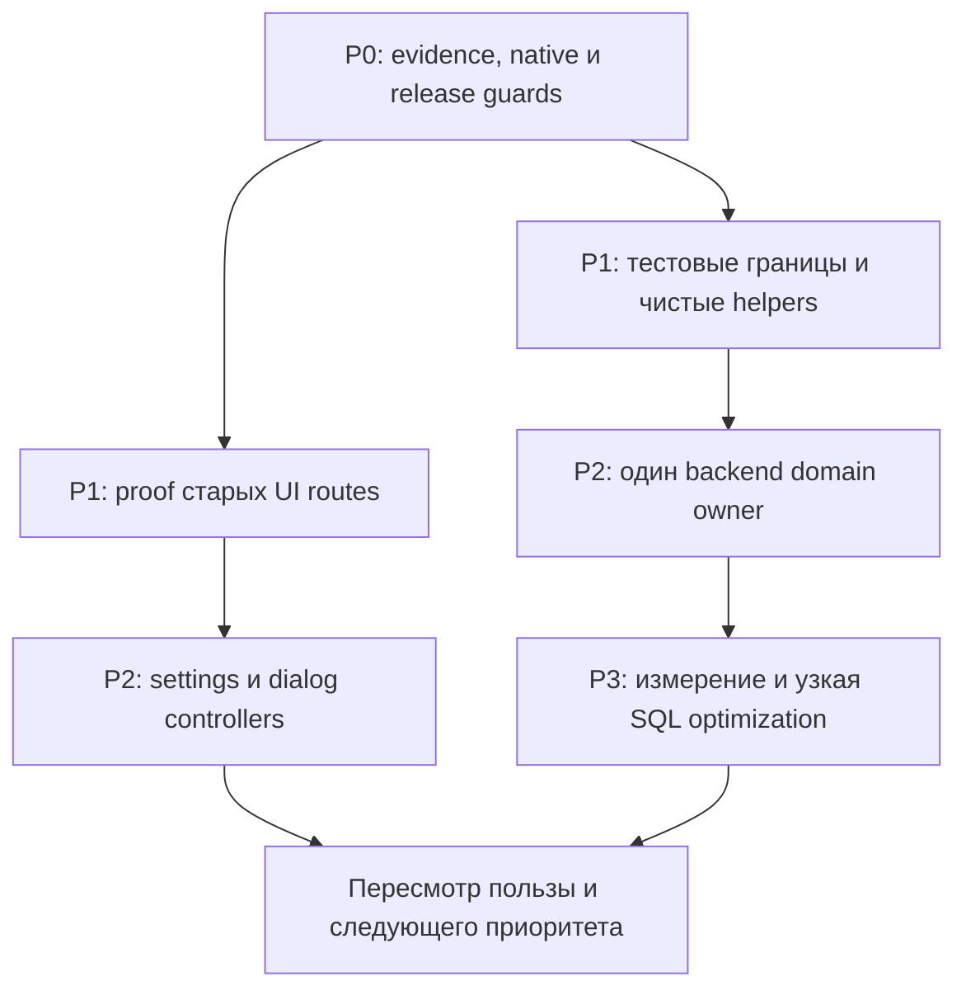

# MAXIM: безопасный рефакторинг и удобство работы агентов

Дата: 1 ноября 2026. Проверенный source: `6eda89cbce40ba5331a5325a63f9175fb9a4c18c`.
Статус: **план; реализация микроцелей не начата**. Основание и ограничения —
[технический аудит](../../development/refactoring-audit-2026-11-01.md).
Этот документ задаёт порядок общей программы, сохраняя действующие продуктовые требования,
incident gates и границы разрешений. Он не разрешает destructive recovery или публикации.

Максимальный ожидаемый выигрыш при ограниченном риске дают: достоверные focused/native
проверки; меньшие тестовые стенды; удаление доказанно недостижимых UI-веток; чистые
функции вместо части legacy; независимое владение одним доменом. Изменения SQL selection,
очередей и выполнения внешних действий требуют отдельного измерения и идут позже.
Численных обещаний ускорения без baseline здесь нет. Программа содержит 54 рабочие
микроцели и четыре отдельно отложенные границы Z01–Z04.

## Приоритеты и исполнение

| Очередь  | Результат                                                                       | Почему раньше                                                                         |
| -------- | ------------------------------------------------------------------------------- | ------------------------------------------------------------------------------------- |
| P0       | Доказуемые проверки и карта ограничений выпуска                                 | Иначе extraction может пройти mocks, пропустить native cases или заблокировать deploy |
| P1       | Меньше общего тестового контекста, чистые helpers, удалённый UI-код после proof | Большой выигрыш навигации с небольшим изменением поведения                            |
| P2       | Один независимый домен за раз; ясные UI controllers/ports                       | Уменьшение реальной связности, а не числа строк                                       |
| P3       | Измеренная стоимость SQL/выпуска/secondary tooling                              | Большой возможный выигрыш, но выше цена доказательства                                |
| Отложено | Перестройка execution/recovery/state machines                                   | Не начинать без отдельного correctness proof                                          |

Одна микроцель — один проверяемый результат. Исследовательский шаг может закончиться
без изменения кода. В один PR допустимы лишь непосредственно связанные шаги одной
границы; нельзя объединять structural move, исправление продукта, SQL optimization и
смену retry policy. Одновременно активен один implementation/release этап;
независимый read-only review разрешён.

Стрелки обозначают зависимости, а не параллельные runtime workstreams. После первых
P1 результатов нужно пересчитать приоритеты по реальным затратам; не выполнять весь
список автоматически ради завершения программы.

## Общий критерий безопасности

Для каждой микроцели перед редактированием:

1. Зафиксировать checkout/SHA/ownership и проверить живой diff; вызвать `context.mjs`
   с implementation, callers и doubles. Состояние длительной работы хранить приватно.
2. По [behavior evidence](../../development/behavior-evidence.md) записать ожидаемое
   поведение и источник. Unresolved behavior исследовать; не закреплять дефект snapshot-тестом.
3. Сохранить HTTP/errors/defaults, callback/queue payloads, persisted readers и keys,
   bot assignments, exact authority и порядок SQL/cache/external effects. Отдельно
   проверить clocks, TTL, дедлайны, null/unknown и principal/entity scope.
4. Запустить необходимые focused cases до/после; при storage/lock/race invariant —
   настоящие PostgreSQL/Redis. Проверить executed/skipped cases, а не один exit code.
5. Для переносимого backend-кода найти source predicates выпуска и rollback fixtures.
   Для DI проверить singleton identity и runtime graph; для UI — действия/запросы,
   lazy assets, cold/warm переходы и budgets, когда они затронуты.
6. Выполнить planner scope, owned formatting и `git diff --check`. Финальный aggregate
   выполняет commit helper один раз. Публичные wrappers сохраняют codegen locks.
7. Runtime: exact-SHA Required + CodeQL, штатный scoped deploy, manifest/identity/strict
   smoke, затем применимые acceptance gates. Для общего API image обновляются все
   роли/auxiliaries по действующей topology, stores не пересоздаются.

Документация/тесты/tooling не требуют runtime deploy. Планировочный dry-run не является
проверкой. Не копировать старый CI success на новый SHA и не повторять зелёный aggregate
для заполнения статуса. Точный набор проверок выбирается по реальному diff.

Отмена структурного изменения — обратимый code revert **после** проверки допустимости
reader/rollback target; он не означает откат БД, replay effects или снятие fences.
DDL требует отдельного expand/compatibility решения. После unknown SEND/DELETE rollback
не разрешает повторить действие. При изменении порядка guards, потере identity, новых
необъяснённых skips, несовместимых readers или изменении публичного результата этап
останавливается для разбора, а не «чинится» ослаблением теста/guard/budget.

## P0 — подготовить проверяемые границы

Все строки ниже — TODO. Ссылки E01–E09 ведут к разделам технического аудита.

| ID  | Зависимость | Микроцель и конкретный результат                                                                                                                                                                | Проверка завершения                                                                                                                       |
| --- | ----------- | ----------------------------------------------------------------------------------------------------------------------------------------------------------------------------------------------- | ----------------------------------------------------------------------------------------------------------------------------------------- |
| A01 | —           | Обновить snapshot выбранного SHA и маленькую карту сценариев текущего этапа: expected result, owner, callers, doubles, evidence                                                                 | Состояние воспроизводимо, inherited edits сохранены; нет claim полноты из текущего кода                                                   |
| A02 | A01         | Сверить native suite → stores → обязательный CI owner / явный opt-in; отдельно восемь кандидатов [E01](../../development/refactoring-audit-2026-11-01.md#e01-native-ci)                         | Для каждого есть решение и реальный selection с правильными env либо документированное исключение                                         |
| A03 | A02         | Добавить отсутствующие native selections по одному домену, без смены runner/shard architecture                                                                                                  | Cases реально исполнились на stores; измерены длительность и skips; benchmark остаётся отдельным opt-in                                   |
| A04 | A02         | Вынести explicit native paths выбранного baseline (123 на SHA аудита) из shell-строки в checked literal inventory, сохранив публичный locked runner                                             | Старое и новое множества/аргументы равны; неизвестные пути и пропавший файл отвергаются; без переразбиения shards                         |
| A05 | A04         | Подключить этот inventory к focused classification и контролю CI owner; добавить отказ на новый native suite без owner                                                                          | Tests selection/env forwarding, включая mixed unit/native suite; mandatory native cases нельзя скрыть skip                                |
| A06 | A01         | Составить browser evidence map для settings/dialog/shop/publications: существующие pure/source/browser/visual cases и реальный CI/local owner                                                   | Учитываются оба текущих browser shards и visual smoke; отсутствие явного script не названо отсутствием всего покрытия                     |
| A07 | A06         | Ввести один literal browser profile inventory для existing explicit CI/focused selections, если обе стороны действительно используют его                                                        | Equivalence старого списка и нового; сохраняются публичные scripts, retries/timeouts и report/exit contract; расширение покрытия отдельно |
| A08 | A01         | Найти source predicates/rollback readers для первого runtime extraction и добавить недостающие negative fixtures [E02](../../development/refactoring-audit-2026-11-01.md#e02-deployment-guards) | Missing file, old reader, reordered guard и unsafe target отвергаются; безопасный перенос можно проверить без VPS                         |
| A09 | A01         | Добавить короткие domain maps в existing scoped references; отметить устаревшие статусы старых планов                                                                                           | Один актуальный указатель, сохранены safety/product decisions и incident history; `check:docs` и guidance budgets                         |
| A10 | A01         | Замерить 3–5 типовых agent tasks: найденные файлы/контекст, время первого focused результата, исправления команды, skips                                                                        | Есть одинаковая методика до/после, без частных traces в Git; выбран один следующий runtime этап                                           |

A08 обязателен до backend moves, но не требует заранее переписывать все 567 source predicates.
A04 сначала сохраняет выбранное множество; добавления A03 затем согласуются отдельным diff.
Допустимо сначала выпустить A03 как узкий CI fix, затем строить inventory из обновлённого
проверенного списка: новый baseline фиксируется явно. Нельзя смешать сравнение списков
с незаметным исключением старых suites.

## P1 — тестовые границы и чистые функции

Основание: [E03](../../development/refactoring-audit-2026-11-01.md#e03-backend-boundaries),
[E04](../../development/refactoring-audit-2026-11-01.md#e04-private-control-and-max).

| ID  | Зависимость | Микроцель и конкретный результат                                                                                         | Проверка завершения                                                                                                                                        |
| --- | ----------- | ------------------------------------------------------------------------------------------------------------------------ | ---------------------------------------------------------------------------------------------------------------------------------------------------------- |
| T01 | A01         | Разделить один полный domain describe из `admin.service.spec.ts`; первым взять домен ближайшего runtime шага             | Те же имена/число cases, setup/cleanup и observable assertions; focused old/new перед финальным aggregate                                                  |
| T02 | T01         | Сделать typed harness только для перенесённого домена: real contract `Pick`/`satisfies`, явный отказ неожиданного вызова | Не используется новый all-domain fixture; ловится drift сигнатуры и неизвестный вызов; fixtures не меняют SQL semantics                                    |
| T03 | T02         | Убрать в затрагиваемом native harness пустые guard doubles; сохранить real stores и transport isolation                  | Нужный production guard действительно вызывается; отдельный runtime graph подтверждает DI, запуск lifecycle не заявлен                                     |
| T04 | A08,T01     | Вынести private-bot rules text/items/sanctions/plural pure helpers; callback/session ownership оставить на месте         | Existing settings/alert-only/markup-limit cases до/после; точные тексты, порядок, max length; новый renderer не дублирует уже выделенный settings renderer |
| T05 | A08         | Вынести один чистый MAX payload cluster после census private callers                                                     | MAX forwarding/null/malformed/unknown attachments/dialog-button cases; transport/admission/final guard order тот же                                        |
| T06 | A08         | Вынести webhook membership projection values; точки чтения часов и dedupe оставить прежними                              | Duplicate join repair, cross-bot granularity, commit-before-cache; SQL/native checks при затрагивании storage boundary                                     |
| T07 | T04/T05/T06 | Уменьшить соответствующий guard ceiling после законченного переноса и проверить public facade callers                    | `check:refactor-guards`; нет новых legacy imports, unsafe contexts или переименования ради обхода guard                                                    |

T01 — шаблон одного среза, а не разрешение одновременно разнести все 31 тысячу строк.
Разделение tests и изменение production implementation должны иметь независимо
объяснимый diff. Полезные existing tests: `admin-domain-allowlist-runtime.spec.ts`,
`admin-domain-allowlist-runtime-context.spec.ts`, `admin-legacy-port.providers.spec.ts`,
`runtime-role-graph.spec.ts`, `private-control.service.spec.ts`, `max-client.service.spec.ts`,
`webhook.service.spec.ts`. Сначала выбрать cases; не запускать весь этот перечень для
каждого изменения.

## P1 — доказать и убрать старые publishing-ветки settings

Основание: [E05](../../development/refactoring-audit-2026-11-01.md#e05-frontend-state).
Возможный выигрыш — уменьшение state/effects/imports и контекста; размер bundle проверяется
отдельно, заранее не обещается.

| ID  | Зависимость | Микроцель и конкретный результат                                                                     | Проверка завершения                                                                                                                       |
| --- | ----------- | ---------------------------------------------------------------------------------------------------- | ----------------------------------------------------------------------------------------------------------------------------------------- |
| U01 | A06         | Перечислить все runtime/dynamic/fixture callers chat/channel settings и все retired publishing links | У каждой ветки указан reachable caller либо недостижимость; общие helpers выделены отдельно                                               |
| U02 | U01         | Проверить реальный App browser flow: retired link → PublikHandoff, без settings/publishing requests  | Browser наблюдает network и mount outcome; обычные settings/rules/shop/giveaway/polls продолжают работать                                 |
| U03 | U02         | Удалить одну доказанно недостижимую chat settings publishing-ветку вместе только с её state/effects  | Draft/apply/rules/handoff cases; публичные query/deep links и shared composer consumers сохранены                                         |
| U04 | U03         | Отдельно выполнить тот же proof/removal для channel settings                                         | Channel settings browser flow, обычные sections, публикационные handoff; без одновременного нового дизайна                                |
| U05 | U03/U04     | Удалить ставшие неиспользуемыми imports/CSS; уменьшить ceilings                                      | Cold и warm cross-route styles, Android/iPhone keyboard layouts по затронутому scope; не удалены shared assets                            |
| U06 | U05         | Сравнить production-origin build/budgets с одинаковыми env/lockfile и повторить типовую agent task   | Сохранены startup + incremental route budgets; записан фактический выигрыш/его отсутствие; нет увеличения лимита ради зелёного результата |

Если U01/U02 выявят действующего caller, удаление соответствующей ветки прекращается.
Её изолировать можно отдельным решением с подтверждённым поведением. Для независимого
F01 достаточно принятого решения U02 сохранить ветку и исходных bundle/task замеров;
удаление U03–U06 не является обязательным. Ранее утверждённые
[продуктовые решения](../../development/miniapp-product-decisions.md) сохраняются.

## P2 — один настоящий backend domain owner

Первый кандидат — allowlist: уже выделенный runtime с явным context, но legacy остаётся
посредником. Цель — не создать ещё один facade поверх всего `AdminService`.

| ID  | Зависимость | Микроцель и конкретный результат                                                                                 | Проверка завершения                                                                                                            |
| --- | ----------- | ---------------------------------------------------------------------------------------------------------------- | ------------------------------------------------------------------------------------------------------------------------------ |
| B01 | T01,T02,A08 | Составить allowlist census: controller, manual service, private bot, network settings, scheduled cleanup и tests | Нет пропущенных direct private calls; записаны transaction/authority/cache owners                                              |
| B02 | B01         | Ввести узкий доменный контракт и authority port вместо типов через `Parameters<AdminService[...] >`              | Типы независимы от legacy class; никаких широких object/unknown context casts; известен путь удаления временного adapter       |
| B03 | B02         | Привязать новый фасад к существующему runtime/state owner; переключить одного consumer                           | Singleton/provider graph tests, focused behavior; SQL/audit/cache ordering без изменений                                       |
| B04 | B03         | Последовательно переключить manual/private/network consumers, не меняя их authorization/options                  | Admin/private cases и реальные network allowlist/settings races; skipAdminCheck не расширяется                                 |
| B05 | B04         | Перенести DI ownership и удалить только доказанно неиспользуемые legacy forwarders                               | Runtime graph всех затронутых profiles; один runtime/cache owner; floors/negative rollback fixtures и public facade совместимы |
| B06 | B05         | Оценить следующий домен по fan-out/churn/стоимости проверки; выбрать максимум один                               | Объём обязательного контекста и число зависимостей реально снизились; нет нового mega-port или цикла обратно в AdminService    |

Нужные storage доказательства включают existing `network-navigation-allowlist-postgres.spec.ts`
и `network-settings-postgres.spec.ts`, когда меняется wiring/граница их реального вызова.
Если authority невозможно вынести без цикла или разделения state, B05 откладывается:
узкая совместимая граница B03 сама по себе полезна, но не называется полной декомпозицией.

## P2 — settings, dialog и events по границам состояния

| ID  | Зависимость                                              | Микроцель и конкретный результат                                                                              | Проверка завершения                                                                                                                 |
| --- | -------------------------------------------------------- | ------------------------------------------------------------------------------------------------------------- | ----------------------------------------------------------------------------------------------------------------------------------- |
| F01 | U06 либо принятое решение U02 сохранить ветку с baseline | Вынести чистый presentation model одной settings section, без нового общего save/fetch layer                  | Pure result tests и та же секция в browser; `useSettingsDraft` остаётся владельцем revision/conflict                                |
| F02 | F01                                                      | Выделить один законченный settings editor с typed draft/save ports, например allowlist                        | Cross-chat/principal stale results, explicit apply-current/all, validation и native Back; нет новой системы сохранения              |
| F03 | A06                                                      | Вынести dialog immutable message/reaction helpers и затем attachment presentation отдельными commits          | Pure outcomes, exact MIME/URL/fallback; существующие client/request/attachments tests                                               |
| F04 | F03                                                      | Выделить attachment preparation controller с прежним epoch/cancel/identity                                    | Async attachment browser race при смене пользователя, отмена/ошибка и повторный вход; dispatch не меняется                          |
| F05 | F04                                                      | Отдельно выделить dialog query/mutation controller; scroll/focus оставить на прежнем owner                    | Send/edit/delete/reaction success+failure, optimistic rollback, terminal stop/cancel, native keyboard; оба comment browser profiles |
| F06 | A06                                                      | Выделить один Events workspace: сначала dashboard read state, participant mutations — только следующим срезом | Range/freshness/coverage/cache и loaded target identity; cached view не становится authority для mutation                           |

F03 не зависит от удаления settings-кода и может быть выбран следующим этапом вместо
F01/F02, но не вести оба runtime этапа одновременно. Имеющиеся feed/rules/subscription
hooks, shop journal и Safety Desk guard не переписываются под универсальный async hook.

## P2 — contracts и входные данные

| ID  | Зависимость | Микроцель и конкретный результат                                                                                   | Проверка завершения                                                                                                       |
| --- | ----------- | ------------------------------------------------------------------------------------------------------------------ | ------------------------------------------------------------------------------------------------------------------------- |
| C01 | A01         | Выбрать один самостоятельный core leaf, перечислить API/UI/admin/runtime consumers и expected/default/error corpus | Контракт подтверждён требованиями; type-only root imports не объявлены bundle-дефектом                                    |
| C02 | C01         | Перенести implementation leaf с сохранением root/settings exports и одного schema instance                         | Public contracts build/test; exports/TS/Jest guard; consumer cases, точные defaults/coercion/issues                       |
| C03 | A01         | Перевести один HTTP baseline exception на `unknown + runtime schema`, сохраняя подтверждённый контракт             | Valid/invalid/missing/default requests и authority cases; удалено только соответствующее baseline exception               |
| C04 | T02/C02/C03 | Включать более строгую локальную типизацию только в затронутой зоне, по реальному gap                              | Contracts/doubles ловят drift; нет blanket `as never/any`, глобальной миграции ESLint или расширенного exception baseline |

Не разрезать большой chatSettings refine/transform без отдельного corpus. Не добавлять
runtime Zod во все UI clients ради одинакового стиля: сначала доказать boundary gap и
учесть route budgets. Prisma models/DDL в этот этап не входят.

## P2 — инструменты агентов и visual tooling

| ID  | Зависимость | Микроцель и конкретный результат                                                                               | Проверка завершения                                                                                                |
| --- | ----------- | -------------------------------------------------------------------------------------------------------------- | ------------------------------------------------------------------------------------------------------------------ |
| V01 | A09         | Добавить в focused один Lastik unit adapter через существующий public workspace script                         | Точные test args/exit/TZ; unknown family по-прежнему fail-closed; existing focused CLI tests                       |
| V02 | V01         | Отдельно добавить Lastik store adapter и API Node-storage family, только по одному за срез                     | Реальные stores/aliases и public wrapper; нет nested stores/raw generation; проверены missing env и signals        |
| V03 | A06/A07     | Подключить проверенные browser profiles к focused, сохраняя один lifecycle/report owner                        | Profile scope, missing browser, failure/cleanup и exact command forwarding; расширение CI списка отдельно          |
| V04 | A01         | Заменить visual-tool newline Git parser каноническим collector                                                 | Rename/delete/untracked/unusual paths, explicit overrides; одинаковый scenario selection на обычных diffs          |
| V05 | V04         | Вынести pure geometry или behaviors одного visual domain; metadata ↔ behavior registry проверить в обе стороны | Те же scenario IDs/actions, deterministic clock, report/exit; один browser/server lifecycle и local/Major defaults |

Выбирать V01–V03 по замерам A10: новый adapter оправдан частым реальным использованием,
а не полнотой каталога. Не вводить второй scheduler поверх plan/verify/focused.

## P3 — runtime performance только после измерения

Основание: [E09](../../development/refactoring-audit-2026-11-01.md#e09-measurement-and-scope)
и действующий domain-specific publisher plan. Эти шаги не возобновляют автоматически
остановленные программы rollout или необратимые операции.

| ID  | Зависимость                           | Микроцель и конкретный результат                                                                  | Проверка завершения                                                                                                            |
| --- | ------------------------------------- | ------------------------------------------------------------------------------------------------- | ------------------------------------------------------------------------------------------------------------------------------ |
| P01 | P0 и выбранный P1/P2 результат принят | Воспроизвести текущий publisher profile 10k/50k и controls с одинаковым SHA/env/load              | SQL calls/rows×loops/buffers, CPU/heap/RSS/event loop, decisions/writes/effects; отдельно cold/warm                            |
| P02 | P01,A08                               | Выбрать минимальный single-snapshot projection без смены списка/порядка/repair/finalizer          | Настоящий Prisma select/GetPayload; mocks учитывают select/orderBy; одинаковый observable результат всех состояний             |
| P03 | P02                                   | Проверить projection на races stop/revoke/edit/cancel/lease/receipt и ручных/legacy callers       | Native public wrappers; неизвестный outcome остаётся fenced; selected input не выдаёт право SEND                               |
| P04 | P03                                   | Выпустить только projection, измерить тот же профиль и применимые production acceptance gates     | Exact-SHA CI/deploy/manifest; эффект измерен, корректность отдельно; при отсутствии пользы пересмотр решения                   |
| P05 | P04                                   | Отдельное go/no-go двухфазного чтения или bounded continuation, без DDL/включения новой authority | Доказаны version/snapshot/composition/order/final authorization и обе стороны гонок; иначе сохранить полный путь               |
| P06 | P01/P04                               | Только при установленном query bottleneck рассмотреть индекс/DDL с migration review               | Local native representative plan/WAL/write cost и reader/rollback compatibility; production только reviewed bounded collectors |

Не заявлять O(1) из-за `LIMIT`, маленького output или quantum. Не удалять finalizer/repair
из-за «обычно не нужен». Нельзя превращать SQL error/empty SKIP LOCKED в completion.
Старые synthetic цифры и pure-helper benchmarks не являются production latency.

## P3 — инфраструктура и независимый Lastik

| ID  | Зависимость                                        | Микроцель и конкретный результат                                                                         | Проверка завершения                                                                                                        |
| --- | -------------------------------------------------- | -------------------------------------------------------------------------------------------------------- | -------------------------------------------------------------------------------------------------------------------------- |
| O01 | A08                                                | Выделить один domain capability checker за существующей shell-функцией                                   | Target Git SHA, refusal reasons/exit/order/floors сохранены; negative target fixtures и affected infra tests               |
| O02 | O01                                                | Оценить единый topology inventory: сначала comparison current TS/Compose/Bash, затем решение о генерации | Ровно те же role/queue/image/auxiliary selections; no drift test; никакой одновременной смены secrets/concurrency          |
| O03 | V01/V02 либо существующие публичные Lastik runners | Lastik: отдельно pure operation hash и diagnostics projection                                            | Побайтово тот же digest/result, input/output types; unit + нужные store cases, dispatch/settle untouched                   |
| O04 | O03                                                | Узкий Lastik runtime port и typed doubles вместо cast полного Store                                      | Health/recovery/due/rate/retry native cases по scope; advisory/policy locks, lease/attempt/uncertainty и bridge совместимы |

Для O03/O04 adapters V01/V02 необязательны: допустимы уже существующие публичные
Lastik команды, для native cases — через `with-test-stores.mjs`. Их работоспособность
нужно подтвердить до изменения store/runtime.

Host-wide cleanup, чужие services, stores recreation и token sharing не входят в программу.
Новые abstraction не должны объединять независимые Major/Lastik state machines.

## Отложенные границы: отдельные решения

| ID  | Участок                                                                     | Условие перед возможной реализацией                                                                                                                   |
| --- | --------------------------------------------------------------------------- | ----------------------------------------------------------------------------------------------------------------------------------------------------- |
| Z01 | Moderation webhook handler/timeout settlement                               | Матрица preparation/failure/persist/timeout/detached/quarantine; native fullpath и latency regression matrix; никакого общего retry wrapper без proof |
| Z02 | Delete-intent executor и независимые причины                                | Явная state machine + lease/dispatch/receipt/unknown/fresh authority proofs; целостные транзакции и regression обеих причин                           |
| Z03 | Publisher readiness/seals/new materialization/DDL                           | Актуальный domain plan, сравнительный native correctness proof и writer census; certificate не выдаёт SEND authority                                  |
| Z04 | Native auxiliaries, broad dependency/compiler upgrades, новые microservices | Измеренный bottleneck и отдельный compatibility/lifecycle rollout; no-network/no-secret/kill-reap и бюджеты сохраняются                               |

Массовое переименование файлов, универсальный repository/event bus/mutation hook, рост
quotas/concurrency, очистка Redis/очередей и удаление uncertainty fences не являются
микроцелями этого плана. Снижение числа строк не оправдывает такие изменения.

## Первый практический цикл

Первый цикл: A01 → A02 → один узкий A03 → A08 для выбранного кандидата → T01/T02.
Затем выбрать **один** результат: T04 (private rules renderer) либо U01/U02 (proof
старых UI routes). Удобство навигации и работа проверок оцениваются после этого,
до следующей runtime extraction. Инвентаризацию A06/A09 можно готовить read-only.

Уже выполненный аудит не закрывает A02/A03: в нём найдена статическая конфигурационная
проблема, но не сверены actual CI reports и не исполнены восемь native candidates.
Не подменять это предварительными зелёными guards.

## Как оценивать результат и передавать работу

После этапа записать baseline/result для выбранных показателей:

- Сколько callers/domains/файлов нужно прочитать для той же типовой задачи; сколько
  общих fixture dependencies и legacy forwarders реально устранено.
- Медиана времени первого focused результата; corrections команд и случайные skips;
  p50/p95 времени нужных suites/shards и peak memory, если это была цель.
- Browser requests/identity/cancellation и startup/incremental assets для UI.
- Runtime latency и SQL/CPU/memory только при измеренном performance scope; отдельно
  от очередного возраста, HTTP 200 и статистики admission.

В handoff указывать: микроцель, SHA, expected behavior, tests и skips, что осталось
неизвестным, written/local/CI/deployed/accepted status и ровно следующий gate.
Проверить ownership до сообщения об окончании. Отсутствующее наблюдение не считается
зелёным; процесс должен иметь identity/log/deadline/exit, collector — ещё heartbeat
и последний успешный sample.

Абсолютной гарантии «ничего не сломается» статический план не даёт. Практический
приоритет — уменьшать blast radius каждого изменения, сохранять подтверждённые
контракты и получать достаточное независимое доказательство перед следующим шагом.
