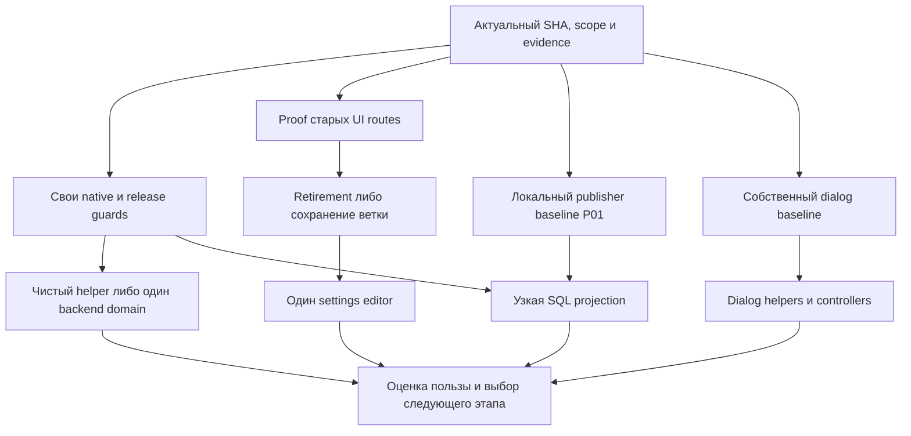

# MAXIM: безопасный рефакторинг и удобство работы агентов

Дата: 1 ноября 2026. Проверенный source: `6eda89cbce40ba5331a5325a63f9175fb9a4c18c`.
Статус: **финальная редакция v2; runtime-рефакторинг не начат**.
Финализация и наблюдения: 01.11.2026 01:07 МСК. Основание и ограничения —
[технический аудит](../../development/refactoring-audit-2026-11-01.md).
Этот документ задаёт порядок общей программы, сохраняя действующие продуктовые требования,
incident gates и границы разрешений. Он не разрешает destructive recovery или публикации.

Максимальный ожидаемый выигрыш при ограниченном риске дают: достоверные focused/native
проверки; меньшие тестовые стенды; удаление доказанно недостижимых UI-веток; чистые
функции вместо части legacy; независимое владение одним доменом. Изменения SQL selection,
очередей и выполнения внешних действий требуют отдельного измерения и идут позже.
Численных обещаний ускорения без baseline здесь нет. Программа содержит 66 рабочих
микроцелей и четыре отдельно отложенные границы Z01–Z04.

## Приоритеты и исполнение

| Очередь  | Результат                                                                       | Почему раньше                                                                         |
| -------- | ------------------------------------------------------------------------------- | ------------------------------------------------------------------------------------- |
| P0       | Доказуемые проверки и карта ограничений выпуска                                 | Иначе extraction может пройти mocks, пропустить native cases или заблокировать deploy |
| P1       | Меньше общего тестового контекста, чистые helpers, удалённый UI-код после proof | Большой выигрыш навигации с небольшим изменением поведения                            |
| P2       | Один независимый домен за раз; ясные UI controllers/ports                       | Уменьшение реальной связности, а не числа строк                                       |
| P3       | Измеренная стоимость SQL/выпуска/secondary tooling                              | Большой возможный выигрыш, но выше цена доказательства                                |
| Отложено | Перестройка execution/recovery/state machines                                   | Не начинать без отдельного correctness proof                                          |

Одна микроцель — один проверяемый результат. Исследовательский шаг может закончиться
без изменения кода. В один PR допустимы лишь непосредственно связанные шаги одной
границы; нельзя объединять structural move, исправление продукта, SQL optimization и
смену retry policy. Одновременно активен один implementation/release этап;
независимый read-only review разрешён.



Стрелки обозначают зависимости, а не параллельные runtime workstreams. После первых
P1 результатов нужно пересчитать приоритеты по реальным затратам; не выполнять весь
список автоматически ради завершения программы.

В таблицах запятая означает все перечисленные prerequisites, «либо» — альтернативу,
а текст после точки с запятой — условие для выбранного scope. Общие стрелки диаграммы
не вводят дополнительных зависимостей: P01 и dialog не ждут декомпозиции Admin/settings.

## Общий критерий безопасности

Для каждой микроцели перед редактированием:

1. Зафиксировать checkout/SHA/ownership и проверить живой diff; вызвать `context.mjs`
   с implementation, callers и doubles. Состояние длительной работы хранить приватно.
2. По [behavior evidence](../../development/behavior-evidence.md) записать ожидаемое
   поведение и источник. Unresolved behavior исследовать; не закреплять дефект snapshot-тестом.
3. Сохранить HTTP/errors/defaults, callback/queue payloads, persisted readers и keys,
   bot assignments, exact authority и порядок SQL/cache/external effects. Отдельно
   проверить clocks, TTL, дедлайны, null/unknown и principal/entity scope.
4. Запустить необходимые focused cases до/после; при storage/lock/race invariant —
   настоящие PostgreSQL/Redis. Проверить executed/skipped cases, а не один exit code.
5. Для переносимого backend-кода найти source predicates выпуска и rollback fixtures.
   Для DI проверить singleton identity и runtime graph; для UI — действия/запросы,
   lazy assets, cold/warm переходы и budgets, когда они затронуты.
6. Выполнить planner scope, owned formatting и `git diff --check`. Финальный aggregate
   выполняет commit helper один раз. Публичные wrappers сохраняют codegen locks.
7. Runtime: exact-SHA Required + CodeQL, штатный scoped deploy, manifest/identity/strict
   smoke, затем применимые acceptance gates. Для общего API image обновляются все
   роли/auxiliaries по действующей topology, stores не пересоздаются.

Документация/тесты/tooling не требуют runtime deploy. Планировочный dry-run не является
проверкой. Не копировать старый CI success на новый SHA и не повторять зелёный aggregate
для заполнения статуса. Точный набор проверок выбирается по реальному diff.

Отмена структурного изменения — обратимый code revert **после** проверки допустимости
reader/rollback target; он не означает откат БД, replay effects или снятие fences.
DDL требует отдельного expand/compatibility решения. После unknown SEND/DELETE rollback
не разрешает повторить действие. При изменении порядка guards, потере identity, новых
необъяснённых skips, несовместимых readers или изменении публичного результата этап
останавливается для разбора, а не «чинится» ослаблением теста/guard/budget.

## P0 — подготовить проверяемые границы

Микроцели описывают следующие изменения. Evidence финализации уже собрана в аудите,
но selectors/decoder/runtime ещё не менялись. Ссылки E01–E11 ведут к разделам аудита.

| ID  | Зависимость | Микроцель и конкретный результат                                                                                                                                                                | Проверка завершения                                                                                                                                                   |
| --- | ----------- | ----------------------------------------------------------------------------------------------------------------------------------------------------------------------------------------------- | --------------------------------------------------------------------------------------------------------------------------------------------------------------------- |
| A01 | —           | Обновить snapshot выбранного SHA и маленькую карту сценариев текущего этапа: expected result, owner, callers, doubles, evidence                                                                 | Состояние воспроизводимо, inherited edits сохранены; нет claim полноты из текущего кода                                                                               |
| A02 | A01         | Сверить native suite → stores → текущий CI owner, missing selection либо явный opt-in; отдельно восемь кандидатов [E01](../../development/refactoring-audit-2026-11-01.md#e01-native-ci)        | Для каждого записаны фактический статус, store-env и выбранный будущий owner либо обоснованное исключение; добавление и выполнение отсутствующего selection — A03/A11 |
| A03 | A02,A12     | Добавить отсутствующую native selection одного домена; выбрать подходящий existing owner по store-env и бюджету                                                                                 | Cases реально выполнены; known skips классифицированы; старое покрытие не сокращено; сохранён резерв setup/upload/cleanup                                             |
| A04 | A02         | Вынести explicit native paths выбранного baseline (123 на SHA аудита) из shell-строки в checked literal inventory, сохранив публичный locked runner                                             | Старое и новое множества/аргументы равны; неизвестные пути и пропавший файл отвергаются; без переразбиения shards                                                     |
| A05 | A04         | Подключить inventory к focused, сохранив UNION native membership и AST store-env; helper-only зависимости описать явно                                                                          | Mixed suites вне explicit lane всё ещё требуют stores; точные args/env; conservative PG+Redis resources не меняются попутно                                           |
| A06 | A01         | Составить browser evidence map для settings/dialog/shop/publications: существующие pure/source/browser/visual cases и реальный CI/local owner                                                   | Учитываются оба текущих browser shards и visual smoke; отсутствие явного script не названо отсутствием всего покрытия                                                 |
| A07 | A06         | Ввести один literal browser profile inventory для existing explicit CI/focused selections, если обе стороны действительно используют его                                                        | Equivalence старого списка и нового; сохраняются публичные scripts, retries/timeouts и report/exit contract; расширение покрытия отдельно                             |
| A08 | A01         | Найти source predicates/rollback readers для первого runtime extraction и добавить недостающие negative fixtures [E02](../../development/refactoring-audit-2026-11-01.md#e02-deployment-guards) | Missing file, old reader, reordered guard и unsafe target отвергаются; безопасный перенос можно проверить без VPS                                                     |
| A09 | A01         | Добавить короткие domain maps в existing scoped references; отметить устаревшие статусы старых планов                                                                                           | Один актуальный указатель, сохранены safety/product decisions и incident history; `check:docs` и guidance budgets                                                     |
| A10 | A01         | Замерить 3–5 типовых agent tasks: найденные файлы/контекст, время первого focused результата, исправления команды, skips                                                                        | Есть одинаковая методика до/после, без частных traces в Git; выбран один следующий runtime этап                                                                       |
| A11 | A02         | Проверять CI evidence по SHA/run/attempt/job/phase и case-level native owner; сохранить terminal job result вместе с report                                                                     | Одинаковые имена artifacts и PASS смешанной suite не скрывают old attempt/skip; разрешённые skips не выдаются за coverage; новый inventory не обязателен              |
| A12 | A02         | Разобрать бюджет native lane на актуальных reports: медленные suites, вариация и резерв setup/upload/cleanup до новых selectors                                                                 | Сохранён timeout attempt1 и успешный rerun; JSON success не подменяет job success; нет повышения deadline или удаления suites ради зелёного                           |

A08 выбирает затрагиваемые predicates до backend moves; чисто тестовый перенос не
требует переделывать все 567 predicates. Учитываются также standalone source checkers.
A04 сначала сохраняет выбранное множество; добавления A03 затем согласуются отдельным diff.
Допустимо сначала выпустить A03 как узкий CI fix, затем строить inventory из обновлённого
проверенного списка: новый baseline фиксируется явно. Нельзя смешать сравнение списков
с незаметным исключением старых suites.

## P0/P1 — authority и совместимость сохранённых операций

Эти небольшие карты дополняют existing domain references; новый центральный registry
прав или новая база задач не создаются. S01/S03 выбираются для конкретной переносимой
границы. Они не заставляют изучать все integrations перед переносом pure renderer.

| ID  | Зависимость                              | Микроцель и конкретный результат                                                                                                   | Проверка завершения                                                                                                                                                                                                              |
| --- | ---------------------------------------- | ---------------------------------------------------------------------------------------------------------------------------------- | -------------------------------------------------------------------------------------------------------------------------------------------------------------------------------------------------------------------------------- |
| S01 | A01                                      | Для выбранного домена связать signature/session/profile → actor/entity authority → final effect и его cases                        | Invalid и expired не смешаны; exact launchBotId, lifecycle, CSRF/tunnel, principal и skip-option owner записаны; новые scopes не выдаются                                                                                        |
| S02 | A01,S01 для auth                         | Отдельным исправлением ввести typed signed-user decoder после подтверждения valid ID/object/error contract                         | Проверены user=null/primitive/array и id=object/array, valid string/number/user_id compatibility, signatures/rotation/freshness/recovery; synthetic HMAC reproduction не объявлен unsigned bypass                                |
| S03 | A01,A08                                  | Для network domain составить writer → trigger/revision → reader version → lease/receipt → rollback map                             | Unsupported persisted reader остаётся unsettled; совместимый v3 поддерживается; receipt co-commit и stale lease guard; source floors включают оба standalone network checkers; native SQL и mocked permission evidence разделены |
| S04 | A01; затронута внешняя protocol boundary | Зафиксировать consumer/provider version pair, command/hash/witness/receipt и unknown/fallback rules в existing integration runbook | Karavan retry сохраняет ID/payload; partial statistics page не отзывает absent; malformed/auth не вызывает fallback; без live pair proof protocol change не продолжается                                                         |

S02 — подтверждённый malformed-input boundary, отдельный от behavior-preserving refactor.
Текущее `null → TypeError` воспроизведено, но production incident и unsigned обход не
установлены. Это не основание менять все accepted IDs или превращать invalid signature
в session recovery. Самостоятельные `S04` изменения протокола не входят в pure extraction.

## P1 — тестовые границы и чистые функции

Основание: [E03](../../development/refactoring-audit-2026-11-01.md#e03-backend-boundaries),
[E04](../../development/refactoring-audit-2026-11-01.md#e04-private-control-and-max).

| ID  | Зависимость                                 | Микроцель и конкретный результат                                                                              | Проверка завершения                                                                                                                           |
| --- | ------------------------------------------- | ------------------------------------------------------------------------------------------------------------- | --------------------------------------------------------------------------------------------------------------------------------------------- |
| T01 | A01                                         | Разделить один полный domain describe из `admin.service.spec.ts`; первым взять домен ближайшего runtime шага  | Те же имена/число cases, setup/cleanup и observable assertions; focused old/new перед финальным aggregate                                     |
| T02 | A01; T01 только для выбранного Admin domain | Типизировать реально затрагиваемый harness выбранного кандидата через real contract и fail-on-unexpected-call | Нет обязательного Admin spec split для чужого домена; actual doubles ловят signature/behavior drift без нового all-domain fixture             |
| T03 | A01,T02 для выбранного feature              | В native harness подключить отсутствующий guard только переносимого feature: photo policy, OCR либо profanity | Указан конкретный real guard/path; transport изолирован; не заявлено, что все остальные guards mocked или что graph test исполняет lifecycle  |
| T04 | A01,A08; собственные private callers/cases  | Вынести private rules text/items/sanctions pure helpers; callback/session owner оставить на месте             | 131 existing private cases — baseline для выбора; settings/alert-only/markup-limit до/после, точные тексты/порядок; Admin spec split не нужен |
| T05 | A08                                         | Вынести один чистый MAX payload cluster после census private callers                                          | MAX forwarding/null/malformed/unknown attachments/dialog-button cases; transport/admission/final guard order тот же                           |
| T06 | A08                                         | Вынести webhook membership projection values; точки чтения часов и dedupe оставить прежними                   | Duplicate join repair, cross-bot granularity, commit-before-cache; SQL/native checks при затрагивании storage boundary                        |
| T07 | T04 либо T05 либо T06; свой scope           | Уменьшить соответствующий guard ceiling после законченного переноса и проверить public facade callers         | `check:refactor-guards`; нет новых legacy imports, unsafe contexts или переименования ради обхода guard                                       |
| T08 | A01; когда затронут harness/lifecycle       | Зафиксировать нормальный shutdown/dispose contract выбранного harness и классифицировать worker warnings      | При воспроизводимом warning — bounded open-handles diagnosis; чистый runInBand не выдаётся за устранение причины обычного worker exit         |

T01 — необязательный для чужих доменов шаблон одного Admin-среза, не разрешение
одновременно разнести все 31 тысячу строк. T04 использует собственный private baseline.
Разделение tests и изменение production implementation должны иметь независимо
объяснимый diff. Полезные existing tests: `admin-domain-allowlist-runtime.spec.ts`,
`admin-domain-allowlist-runtime-context.spec.ts`, `admin-legacy-port.providers.spec.ts`,
`runtime-role-graph.spec.ts`, `private-control.service.spec.ts`, `max-client.service.spec.ts`,
`webhook.service.spec.ts`. Сначала выбрать cases; не запускать весь этот перечень для
каждого изменения.

## P1 — доказать и убрать старые publishing-ветки settings

Основание: [E05](../../development/refactoring-audit-2026-11-01.md#e05-frontend-state).
Возможный выигрыш — уменьшение state/effects/imports и контекста; размер bundle проверяется
отдельно, заранее не обещается.

| ID  | Зависимость                                          | Микроцель и конкретный результат                                                                                                     | Проверка завершения                                                                                                                                                                                     |
| --- | ---------------------------------------------------- | ------------------------------------------------------------------------------------------------------------------------------------ | ------------------------------------------------------------------------------------------------------------------------------------------------------------------------------------------------------- |
| U01 | A06                                                  | Перечислить все runtime/dynamic/fixture callers chat/channel settings и все retired publishing links                                 | У каждой ветки указан reachable caller либо недостижимость; общие helpers выделены отдельно                                                                                                             |
| U02 | U01,A06                                              | Проверить настоящий App retirement matrix; считать ApiTransport requests при in-process preview либо использовать HTTP session mocks | Chat/channel, cold/warm: retired entries без запрещённых endpoint effects; ordinary mixed handoff/error retry сохраняет зафиксированное текущее поведение; прямой page harness не заменяет router proof |
| U03 | U02                                                  | Удалить только одну недостижимую legacyBroadcastWorkspaceRequested-owned ветку chat settings                                         | Достижимый non-publishing handoff=1, header/prefetch/retry и общие helpers сохранены; отдельный U07 не смешан с removal                                                                                 |
| U04 | U03                                                  | Отдельно выполнить тот же proof/removal для channel settings                                                                         | Channel settings browser flow, обычные sections, публикационные handoff; без одновременного нового дизайна                                                                                              |
| U05 | U03 либо U04; свой scope                             | Удалить ставшие неиспользуемыми imports/CSS; уменьшить ceilings                                                                      | Cold и warm cross-route styles, Android/iPhone keyboard layouts по затронутому scope; не удалены shared assets                                                                                          |
| U06 | U05                                                  | Сравнить production-origin build/budgets с одинаковыми env/lockfile и повторить типовую agent task                                   | Сохранены startup + incremental route budgets; записан фактический выигрыш/его отсутствие; нет увеличения лимита ради зелёного результата                                                               |
| U07 | U02; только если подтверждено требование исправления | Отдельно воспроизвести mixed-query error retry с лишним publishing GET и решить его ожидаемый результат                              | Это product correction со своим failing regression и neighboring handoff cases; не выдаётся за удаление недостижимого кода и не блокирует независимый U03                                               |

### Обязательная матрица U02

Проверять chat/channel, cold entry и warm переход из settings; `focus=broadcast&handoff=1`,
`focus=mailing`, `workspace=autoposts`, наличие даже пустого legacyKind/legacyId; обычные
rules/giveaway/polls/storefront, отдельно `focus=giveaway&handoff=1` и load error → retry.
Launch/startapp/hash варианты проверять при затрагивании соответствующего resolver.
Publisher publications/entity screens остаются собственными runtime routes.

Forbidden endpoint set задаётся явно для retired entries. Для обычного mixed-query
фиксируется текущее поведение, включая publishing GET на error retry; его возможное
изменение относится только к U07. Session bootstrap, `/me`, разрешённый favorites
read и module/CSS preload сами не являются нарушением. In-process preview требует
instrumented ApiTransport, HTTP observer один не доказывает no-fetch. Built real App с
session mocks — альтернативный путь; direct page fixture root guard не проверяет.

Если U01/U02 выявят действующего caller, удаление соответствующей ветки прекращается.
Её изолировать можно отдельным решением с подтверждённым поведением. Для независимого
F01 достаточно принятого решения U02 сохранить ветку и исходных bundle/task замеров;
удаление U03–U06 не является обязательным. Ранее утверждённые
[продуктовые решения](../../development/miniapp-product-decisions.md) сохраняются.

## P2 — один настоящий backend domain owner

Первый кандидат — allowlist: уже выделенный runtime с явным context, но legacy остаётся
посредником. Цель — не создать ещё один facade поверх всего `AdminService`.

| ID  | Зависимость                                             | Микроцель и конкретный результат                                                                                      | Проверка завершения                                                                                                                    |
| --- | ------------------------------------------------------- | --------------------------------------------------------------------------------------------------------------------- | -------------------------------------------------------------------------------------------------------------------------------------- |
| B01 | A01,A08,S01,S03                                         | Составить allowlist census: controller/manual/private/network/cleanup, authority/transaction/cache и relevant doubles | Census можно сделать до test-file move; direct private calls и DB trigger/receipt readers учтены                                       |
| B02 | B01; T02 для выбранного harness                         | Ввести узкий доменный контракт и authority port вместо привязки к legacy class                                        | Явно указано, кто установил authority и что suppress-ит каждый skip option; нет широкого context или обратного mega-port               |
| B03 | B02                                                     | Привязать новый фасад к существующему runtime/state owner; переключить одного consumer                                | Singleton/provider graph tests, focused behavior; SQL/audit/cache ordering без изменений                                               |
| B04 | B03,S03                                                 | Последовательно переключить manual/private/network consumers без изменения authorization/options                      | Native lease/revision/receipt proof и отдельные реальные permission-boundary cases; mocked access success не выдаётся за MAX authority |
| B05 | B04                                                     | Перенести DI ownership и удалить только доказанно неиспользуемые legacy forwarders                                    | Runtime graph всех затронутых profiles; один runtime/cache owner; floors/negative rollback fixtures и public facade совместимы         |
| B06 | B03; после принятого среза B04 либо B05, если он выбран | Оценить следующий домен по fan-out/churn/стоимости проверки; выбрать максимум один                                    | Объём обязательного контекста и число зависимостей реально снизились; нет нового mega-port или цикла обратно в AdminService            |

Нужные storage доказательства включают existing `network-navigation-allowlist-postgres.spec.ts`
и `network-settings-postgres.spec.ts`, когда меняется wiring/граница их реального вызова.
Если authority невозможно вынести без цикла или разделения state, B05 откладывается:
узкая совместимая граница B03 сама по себе полезна, но не называется полной декомпозицией.

## P2 — settings, dialog и events по границам состояния

| ID  | Зависимость                                              | Микроцель и конкретный результат                                                                              | Проверка завершения                                                                                                                 |
| --- | -------------------------------------------------------- | ------------------------------------------------------------------------------------------------------------- | ----------------------------------------------------------------------------------------------------------------------------------- |
| F01 | U06 либо принятое решение U02 сохранить ветку с baseline | Вынести чистый presentation model одной settings section, без нового общего save/fetch layer                  | Pure result tests и та же секция в browser; `useSettingsDraft` остаётся владельцем revision/conflict                                |
| F02 | F01                                                      | Выделить один законченный settings editor с typed draft/save ports, например allowlist                        | Cross-chat/principal stale results, explicit apply-current/all, validation и native Back; нет новой системы сохранения              |
| F03 | A06,C04 при изменении fixture                            | Вынести dialog immutable message/reaction helpers с явными входами/выходами                                   | Pure outcome/client/request cases; неизменяемость и optimistic data semantics без переноса async/controller                         |
| F07 | F03                                                      | Отдельно вынести attachment presentation с прежними MIME/URL/preview/fallback и accessibility                 | Browser attachment cases и keyboard/focus по затронутому UI; fixture limitations названы                                            |
| F04 | F07                                                      | Выделить attachment preparation controller с прежними epoch/cancel/identity                                   | Async import/read race при смене principal/edit draft, отмена/ошибка/повторный вход; dispatch и исходный body не меняются           |
| F05 | F04                                                      | Отдельно выделить dialog query/mutation controller; scroll/focus оставить на прежнем owner                    | Send/edit/delete/reaction success+failure, optimistic rollback, terminal stop/cancel, native keyboard; оба comment browser profiles |
| F06 | A06                                                      | Выделить один Events workspace: сначала dashboard read state, participant mutations — только следующим срезом | Range/freshness/coverage/cache и loaded target identity; cached view не становится authority для mutation                           |

F03 не зависит от удаления settings-кода и может быть выбран следующим этапом вместо
F01/F02, но не вести оба runtime этапа одновременно. Имеющиеся feed/rules/subscription
hooks, shop journal и Safety Desk guard не переписываются под универсальный async hook.

## P2 — contracts и входные данные

| ID  | Зависимость             | Микроцель и конкретный результат                                                                                   | Проверка завершения                                                                                                                                 |
| --- | ----------------------- | ------------------------------------------------------------------------------------------------------------------ | --------------------------------------------------------------------------------------------------------------------------------------------------- |
| C01 | A01                     | Выбрать один самостоятельный core leaf, перечислить API/UI/admin/runtime consumers и expected/default/error corpus | Контракт подтверждён требованиями; type-only root imports не объявлены bundle-дефектом                                                              |
| C02 | C01                     | Перенести leaf implementation с прежними root/settings exports и одним schema instance                             | Public build/test, source/Jest mappings И built-package import/parser/identity; точные defaults/coercion/issues и consumers                         |
| C03 | A01                     | Перевести один HTTP baseline exception на `unknown + runtime schema`, сохраняя подтверждённый контракт             | Valid/invalid/missing/default requests и authority cases; удалено только соответствующее baseline exception                                         |
| C04 | A01; A06 для UI harness | Добавить узкую typecheck выбранных UI/contracts fixture builders через actual types/schema.parse/satisfies         | Проверяется именно test/fixture файл: production tsconfig его не включает; transpile pass не подменяет types; без blanket casts и массовой миграции |

Не разрезать большой chatSettings refine/transform без отдельного corpus. Не добавлять
runtime Zod во все UI clients ради одинакового стиля: сначала доказать boundary gap и
учесть route budgets. Prisma models/DDL в этот этап не входят.

## P2 — инструменты агентов и visual tooling

| ID  | Зависимость                        | Микроцель и конкретный результат                                                                  | Проверка завершения                                                                                            |
| --- | ---------------------------------- | ------------------------------------------------------------------------------------------------- | -------------------------------------------------------------------------------------------------------------- |
| V01 | A09,A10                            | Добавить в focused один Lastik unit adapter через существующий public workspace script            | Точные test args/exit/TZ; unknown family по-прежнему fail-closed; existing focused CLI tests                   |
| V02 | V01; измеренное использование      | Добавить отдельно Lastik store adapter через public store wrapper                                 | UTC/aliases/missing env/signals; нет nested stores; поведение existing runner сохранено                        |
| V06 | A10; измеренное использование      | Отдельно добавить API test/\*.node.ts adapter с сохранением публичного storage runner             | Точные args/exit/codegen locks и реальные stores; изменение Lastik family не смешано с этим adapter            |
| V03 | A06,A10; A07 если принят inventory | Подключить проверенные browser profiles к focused, сохраняя один lifecycle/report owner           | Profile scope, missing browser, failure/cleanup и exact command forwarding; расширение CI списка отдельно      |
| V04 | A01                                | Заменить visual-tool newline Git parser каноническим collector                                    | Rename/delete/untracked/unusual paths, explicit overrides; одинаковый scenario selection на обычных diffs      |
| V05 | V04                                | Вынести pure geometry/report computation одной visual области                                     | Те же inputs/results, deterministic clock и report fields; один lifecycle owner                                |
| V07 | V04                                | Отдельно перенести scenario behaviors одного домена и проверить metadata ↔ registry в обе стороны | Те же IDs/actions/порядок, failures/cleanup, local/Major defaults; screenshots не подменяют запросы/результаты |

Выбирать V01–V03 по замерам A10: новый adapter оправдан частым реальным использованием,
а не полнотой каталога. Не вводить второй scheduler поверх plan/verify/focused.

## P3 — runtime performance только после измерения

Основание: [E09](../../development/refactoring-audit-2026-11-01.md#e09-measurement-and-scope)
и действующий domain-specific publisher plan. Эти шаги не возобновляют автоматически
остановленные программы rollout или необратимые операции.

| ID  | Зависимость                                | Микроцель и конкретный результат                                                                                                                              | Проверка завершения                                                                                                                                                |
| --- | ------------------------------------------ | ------------------------------------------------------------------------------------------------------------------------------------------------------------- | ------------------------------------------------------------------------------------------------------------------------------------------------------------------ |
| P01 | A01; существующий public publisher profile | Воспроизвести local publisher profile 10k/50k в одноразовых stores на фиксированном SHA/env/load; fixtures записываются локально, внешние effects изолированы | Полные результаты/SQL rows×loops/buffers/CPU/heap/RSS/event loop; нет production data/provider calls; для измерения не требуется несвязанный UI/private extraction |
| P02 | P01,A08                                    | Выбрать минимальный single-snapshot projection без смены списка/порядка/repair/finalizer                                                                      | Настоящий Prisma select/GetPayload; mocks учитывают select/orderBy; одинаковый observable результат всех состояний                                                 |
| P03 | P02                                        | Проверить projection на races stop/revoke/edit/cancel/lease/receipt и ручных/legacy callers                                                                   | Native public wrappers; неизвестный outcome остаётся fenced; selected input не выдаёт право SEND                                                                   |
| P04 | P03                                        | Выпустить только projection, измерить тот же профиль и применимые production acceptance gates                                                                 | Exact-SHA CI/deploy/manifest; эффект измерен, корректность отдельно; при отсутствии пользы пересмотр решения                                                       |
| P05 | P04                                        | Отдельное go/no-go двухфазного чтения или bounded continuation, без DDL/включения новой authority                                                             | Доказаны version/snapshot/composition/order/final authorization и обе стороны гонок; иначе сохранить полный путь                                                   |
| P06 | P01 либо P04; установлен query bottleneck  | Только при установленном query bottleneck рассмотреть индекс/DDL с migration review                                                                           | Local native representative plan/WAL/write cost и reader/rollback compatibility; production только reviewed bounded collectors                                     |

Не заявлять O(1) из-за `LIMIT`, маленького output или quantum. Не удалять finalizer/repair
из-за «обычно не нужен». Нельзя превращать SQL error/empty SKIP LOCKED в completion.
Старые synthetic цифры и pure-helper benchmarks не являются production latency.

## P3 — инфраструктура и независимый Lastik

| ID  | Зависимость                                        | Микроцель и конкретный результат                                                                         | Проверка завершения                                                                                                        |
| --- | -------------------------------------------------- | -------------------------------------------------------------------------------------------------------- | -------------------------------------------------------------------------------------------------------------------------- |
| O01 | A08                                                | Выделить один domain capability checker за существующей shell-функцией                                   | Target Git SHA, refusal reasons/exit/order/floors сохранены; negative target fixtures и affected infra tests               |
| O02 | A01; A08 при изменении release checker             | Оценить единый topology inventory: сначала comparison current TS/Compose/Bash, затем решение о генерации | Ровно те же role/queue/image/auxiliary selections; no drift test; никакой одновременной смены secrets/concurrency          |
| O03 | A01; подтверждён public Lastik runner своего scope | Выделить только pure operation hash вместо дублей                                                        | Побайтово тот же serialized input/digest и unit cases; dispatch/settle не меняются                                         |
| O05 | A01; existing Lastik runners                       | Отдельно вынести pure diagnostics projection с input/output types                                        | Те же null/unknown/status snapshots; hashes, store transaction и runtime port не меняются в этом шаге                      |
| O04 | A01; подтверждены свои runtime/store baselines     | Узкий Lastik runtime port и typed doubles вместо cast полного Store                                      | Health/recovery/due/rate/retry native cases по scope; advisory/policy locks, lease/attempt/uncertainty и bridge совместимы |

Для O03/O04 adapters V01/V02 необязательны: допустимы уже существующие публичные
Lastik команды, для native cases — через `with-test-stores.mjs`. Их работоспособность
нужно подтвердить до изменения store/runtime.

Host-wide cleanup, чужие services, stores recreation и token sharing не входят в программу.
Новые abstraction не должны объединять независимые Major/Lastik state machines.

## Отложенные границы: отдельные решения

| ID  | Участок                                                                     | Условие перед возможной реализацией                                                                                                                   |
| --- | --------------------------------------------------------------------------- | ----------------------------------------------------------------------------------------------------------------------------------------------------- |
| Z01 | Moderation webhook handler/timeout settlement                               | Матрица preparation/failure/persist/timeout/detached/quarantine; native fullpath и latency regression matrix; никакого общего retry wrapper без proof |
| Z02 | Delete-intent executor и независимые причины                                | Явная state machine + lease/dispatch/receipt/unknown/fresh authority proofs; целостные транзакции и regression обеих причин                           |
| Z03 | Publisher readiness/seals/new materialization/DDL                           | Актуальный domain plan, сравнительный native correctness proof и writer census; certificate не выдаёт SEND authority                                  |
| Z04 | Native auxiliaries, broad dependency/compiler upgrades, новые microservices | Измеренный bottleneck и отдельный compatibility/lifecycle rollout; no-network/no-secret/kill-reap и бюджеты сохраняются                               |

Массовое переименование файлов, универсальный repository/event bus/mutation hook, рост
quotas/concurrency, очистка Redis/очередей и удаление uncertainty fences не являются
микроцелями этого плана. Снижение числа строк не оправдывает такие изменения.

## Первый практический цикл

На фиксированном source уже подтверждены локальные baseline и реальные CI receipts;
следующий executable этап выбирается по фактическому риску, без искусственной цепочки
несвязанных extraction:

1. A01/A02: освежить identity/owner по изменившемуся scope; до улучшений tooling/context
   снять маленький baseline A10. Затем A12 → один A03 и A11,
   чтобы отсутствующая native-проверка стала обязательной без потери CI budget.
2. Для ближайшего runtime кандидата — его authority/callers/fixtures и A08. Затем выбрать
   **один**: S02 (отдельная malformed-auth correction), T04 (pure private renderer) либо
   U01/U02 → U03 (UI retirement после точного proof).
3. T01/T02 делать только когда выбранный домен выигрывает от test harness extraction;
   allowlist B01/S03 можно исследовать до переноса общего spec. A04/inventory и adapters
   не блокируют полезный узкий fix, который уже имеет безопасный public runner.
4. После принятого результата сравнить A10-показатели и выбрать следующий этап.

Аудит закрывает исходную неизвестность «исполняются ли восемь кандидатов на stores»:
локально все прошли. Он не закрывает A03 — CI selectors ещё не добавлены. Известный
timeout CI и неповторившийся local worker warning сохранены с разными статусами; ни
один не объявлен исправленным. Готовность плана не означает готовность всех реализаций.

## Риск, результат и конечный критерий программы

| Пакет           | Ожидаемый выигрыш                               | Главный риск                                                | Разрешённый первый результат                                                    |
| --------------- | ----------------------------------------------- | ----------------------------------------------------------- | ------------------------------------------------------------------------------- |
| A02/A03/A11/A12 | Достоверное покрытие и предсказуемый feedback   | False green, пропавший case, job timeout                    | Один native owner с executed cases и полным terminal CI receipt                 |
| T01/T02/C04     | Меньше контекста и обнаружение drift до runtime | Fixture перестала моделировать реальный контракт            | Один typed domain harness с тем же observable corpus                            |
| `S02`           | Корректная signed-input boundary                | Изменение accepted IDs/session semantics                    | Узкий decoder с подтверждёнными valid/invalid cases                             |
| U01–U06         | Меньше state/effects/imports без потери функций | Mixed handoff и shared helpers ошибочно удалены             | Удалена одна доказанно недостижимая ветка; warm/cold реальные flows сохранены   |
| T04–T06         | Изолированная чистая логика                     | Текст/clock/dedupe/guard order изменились                   | Один pure cluster с before/after corpus                                         |
| B/F/S03/S04     | Меньше связности домена                         | Разделён singleton, authority, receipt или principal        | Один законченный owner с native/permission evidence по своим границам           |
| P/O             | Измеренное снижение стоимости                   | Snapshot, reader, lifecycle или effect uncertainty нарушены | Минимальный прошедший correctness gate шаг; отсутствие выигрыша допускает отказ |

У программы нет цели завершить все строки любой ценой. Рабочий этап закончен, когда
его owned diff завершён и проверен, обязательные CI/release/acceptance gates выполнены,
старые readers/fences совместимы, а выбранный показатель улучшен либо гипотеза отвергнута.
Программу пересматривать после первых двух принятых runtime срезов: продолжать только
пакеты с измеренной пользой, отложенные/отвергнутые кандидаты сохранять с причиной.

Карточка каждого будущего этапа в private task record: ID, exact SHA/source digest,
expected/authority, scope/callers, test command + executed/skipped cases, rollback class,
owner state/lifecycle, risk, terminal result и следующий gate. Для persisted/external
изменений отдельно old/new readers/writers и что разрешено после unknown outcome.

Rollback classes: docs/tests/tooling — code revert после проверки inputs; pure runtime —
compatible code/image rollback через штатный wrapper; persisted/reader/DDL — отдельный
compatibility gate, прежний image может быть запрещён; uncertain external effects —
settlement/reconciliation по журналу, никакого нового SEND/DELETE из rollback.

## Проверочные рецепты для следующих срезов

Ниже точные supported команды, а не требование выполнить всё перед каждым Markdown diff.
Preflight выполняется до дорогих запусков; stores используются только для нужного scope.

```bash
node scripts/agent/focused.mjs --test apps/api/src/moderation/private-control.service.spec.ts --json
node scripts/agent/focused.mjs --test apps/api/src/auth/init-data.service.spec.ts --test apps/api/src/auth/init-data.guard.spec.ts --test apps/api/src/auth/miniapp-session-lifecycle.spec.ts --json
node scripts/agent/with-test-stores.mjs --migrate -- node scripts/agent/focused.mjs --test apps/api/src/admin/network-settings-postgres.spec.ts --test apps/api/src/admin/network-settings-supplemental-postgres.spec.ts --json
node scripts/agent/focused.mjs --test apps/miniapp/test/publik-handoff.test.ts --test apps/miniapp/test/launch-route.test.ts --test apps/miniapp/test/auth-query-session.test.ts --test apps/miniapp/test/api-transport.test.ts --json
```

Browser family пока запускается existing scripts напрямую:

```bash
node apps/miniapp/test/settings-draft.browser.mjs
node apps/miniapp/test/comment-dialog-attachments-async.browser.mjs
```

Первый entrypoint дополнительно импортирует settings-stop-words browser: планировать
его фактическую длительность и всю цепочку cleanup. Он покрывает hook и реальную страницу,
но не новый U02 retirement matrix. Chromium/WebKit и MAX WebView — разные evidence;
`settings-overview-navigation.browser.mjs` требует также WebKit. Built startup profile
требует production-origin build и свободный strict port, не запускается по наличию Chromium.

## Как оценивать результат и передавать работу

После этапа записать baseline/result для выбранных показателей:

- Сколько callers/domains/файлов нужно прочитать для той же типовой задачи; сколько
  общих fixture dependencies и legacy forwarders реально устранено.
- Медиана времени первого focused результата; corrections команд и случайные skips;
  p50/p95 времени нужных suites/shards и peak memory, если это была цель.
- Browser requests/identity/cancellation и startup/incremental assets для UI.
- Runtime latency и SQL/CPU/memory только при измеренном performance scope; отдельно
  от очередного возраста, HTTP 200 и статистики admission.

В handoff указывать: микроцель, SHA, expected behavior, tests и skips, что осталось
неизвестным, written/local/CI/deployed/accepted status и ровно следующий gate.
Проверить ownership до сообщения об окончании. Отсутствующее наблюдение не считается
зелёным; процесс должен иметь identity/log/deadline/exit, collector — ещё heartbeat
и последний успешный sample.

Абсолютной гарантии «ничего не сломается» статический план не даёт. Практический
приоритет — уменьшать blast radius каждого изменения, сохранять подтверждённые
контракты и получать достаточное независимое доказательство перед следующим шагом.
